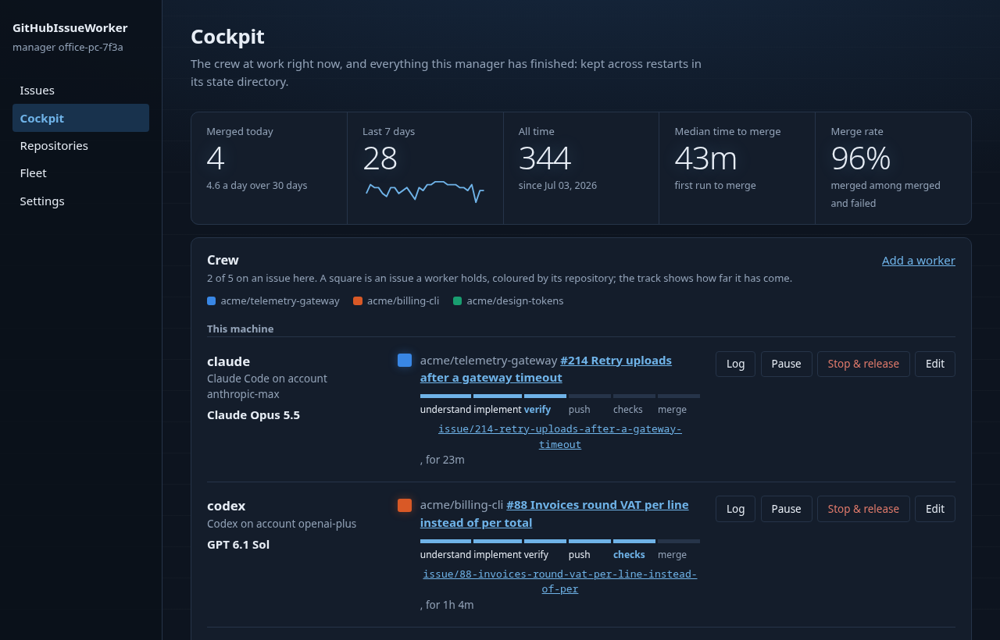
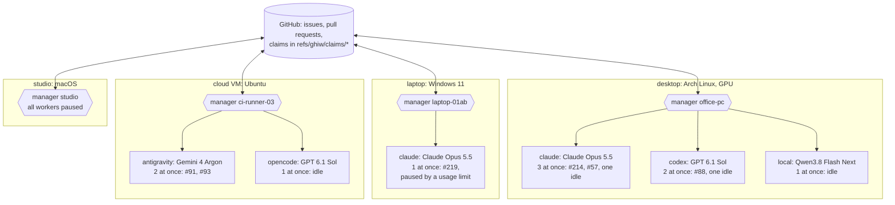
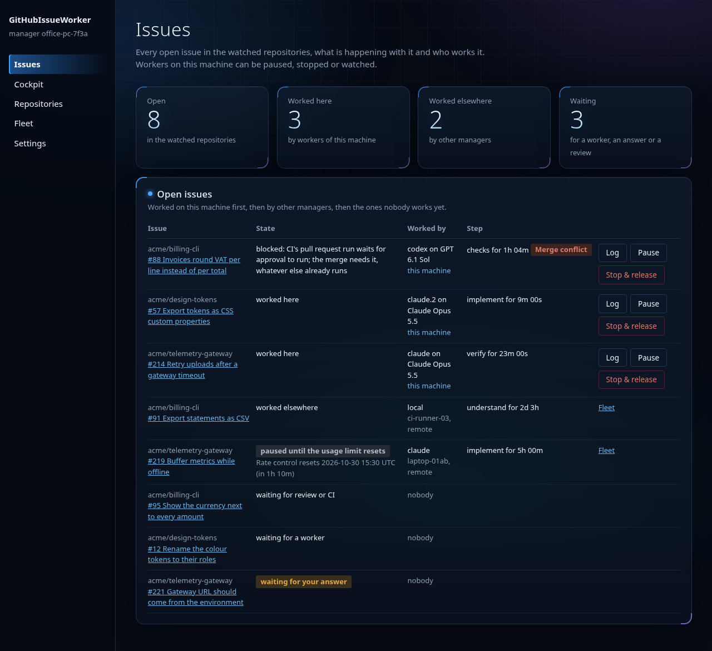
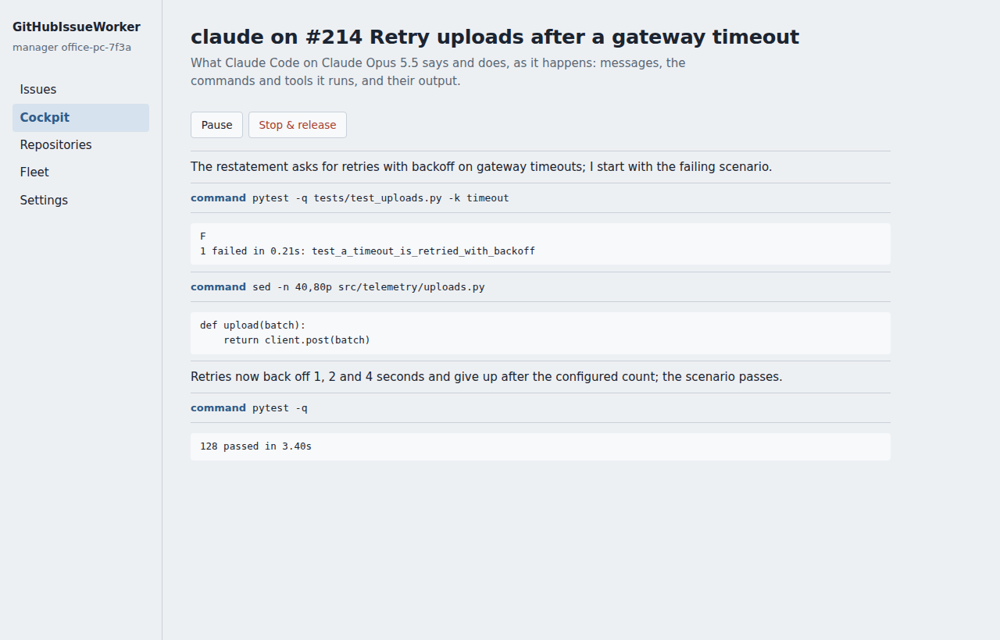
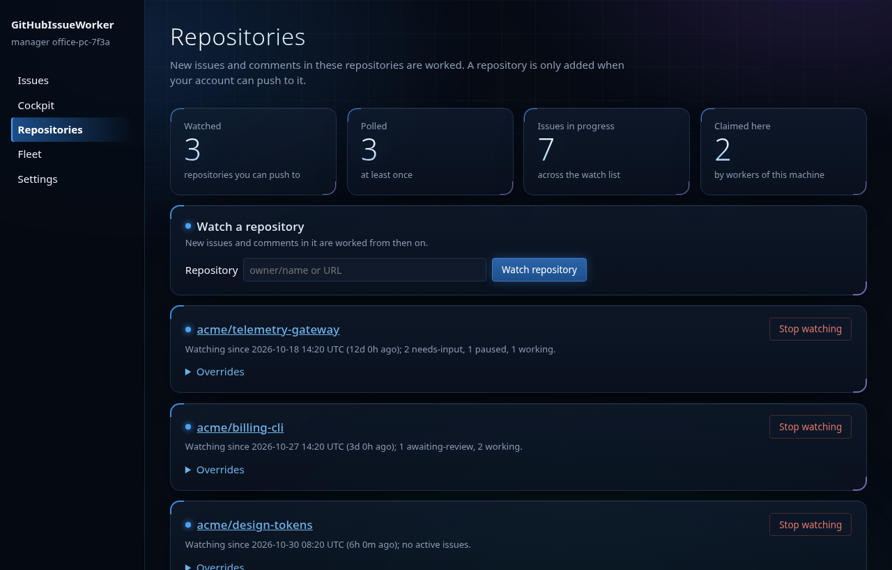
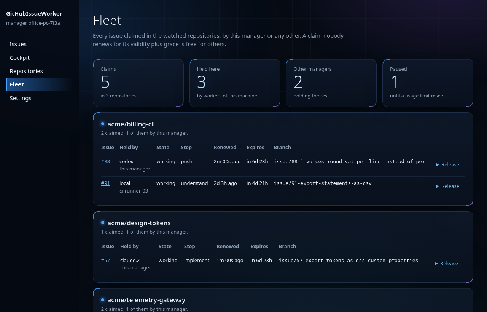
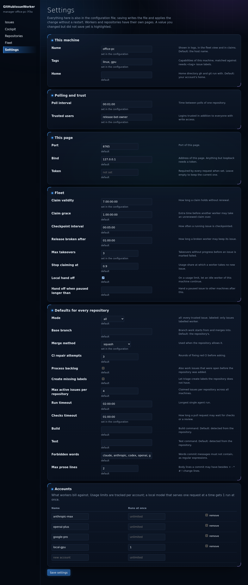
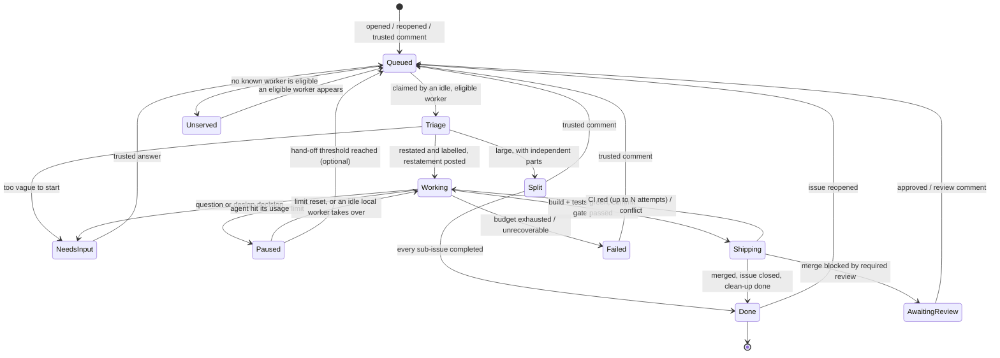

# GitHubIssueWorker

[](https://github.com/Hawkynt/GitHubIssueWorker/blob/main/LICENSE)
[](https://github.com/Hawkynt/GitHubIssueWorker)

[](https://github.com/Hawkynt/GitHubIssueWorker/actions/workflows/ci.yml)


[](https://github.com/Hawkynt/GitHubIssueWorker/stargazers)
[](https://github.com/Hawkynt/GitHubIssueWorker/network/members)
[](https://github.com/Hawkynt/GitHubIssueWorker/issues)


[](https://github.com/Hawkynt/GitHubIssueWorker/releases/latest)
[](https://github.com/Hawkynt/GitHubIssueWorker/releases)
[](https://github.com/Hawkynt/GitHubIssueWorker/releases)

> Write an issue, get a merged pull request. GitHubIssueWorker works each issue in the repositories
> you can push to, from label to merge, by the house rules. Any number of machines and coding agents
> (Claude, Codex, Antigravity, OpenCode, local or cloud) share the work without doing anything twice
> or leaving an issue stranded.



## 🧭 Vision

The issue tracker becomes the only interface a maintainer needs. Writing an issue is the same as
assigning it, a comment is a review, and reopening is "not done yet". Everything between the request
and the merged change is handled by workers that follow the same discipline a careful human
contributor would: the specification is written down before the code, the expected behaviour becomes
executable scenarios, the code speaks the domain's language, and every behaviour starts as a failing
test.

A **worker** is one coding agent (a Claude Code, a Codex, an Antigravity, a Claude Code on a local
model, an OpenCode) that works as many issues at once as its account allows, one per *instance*
(`claude`, `claude.2`, ...), one by default and never more than twenty. A **manager** is the `github-issue-worker`
process on a machine. It steers all of that machine's workers at once, does everything outward-facing
(push, pull request, merge, close, comment) on their behalf, and only after it has checked the
result: build and tests green, every commit conforming to the house rules, no trace of who or what
wrote it. A change
that cannot pass those checks is never shipped. It comes back to the issue as a question.

Managers form a fleet without a server. Any number of them, on desktops, laptops, containers or in
the cloud, watch the same repositories and coordinate through the repositories themselves. A claim on
an issue is an atomic write to a hidden git ref, so exactly one worker works an issue at a time. A
claim lasts up to seven days without renewal, so a laptop closed over a weekend keeps its issue. A
claim nobody has renewed for eight days goes back to the fleet, so a worker that was removed for good
never blocks anything. A worker claims only when it is idle and able to start, so nothing is ever
reserved by someone who cannot work on it. Usage limits are treated as weather, not failure: the
limited worker pauses its issue, takes nothing new, and resumes on its own when the limit resets.



Every machine runs one manager, on whatever operating system it has, with the agents and models
installed there; each polls, pushes, opens and merges pull requests, and claims issues by
compare-and-swap on the same repositories. A worker whose account allows three runs at once works three issues side by side;
another sits idle until an issue it may take turns up. No manager talks to another: they meet only
in the repositories, where each issue has at most one claim.

A local web UI on each manager shows which worker is on which issue, on which local branch, and
gives access to every setting: watched repositories, workers, accounts, fleet behaviour and defaults.
The configuration file and the UI are two views of the same settings.

It is built for one maintainer running many repositories under their own account, and it never acts
on a repository that account cannot push to.

## ✨ Features

- **Watch list of repositories** — add a repository by URL, from the CLI or the UI. Push access is
  verified up front, on every start, and every hour. A repository that loses it is suspended
  with a log entry; other repositories keep running.
- **New issues, new comments, reopened issues** — detected by polling with conditional requests, so
  an idle repository costs no rate limit.
- **Automatic triage** — an unlabelled issue gets labels chosen from the repository's existing label
  set.
- **Spec → scenarios → domain → tests → code** — every issue is worked SDD, BDD, DDD and TDD, in that
  order. See [How an issue is worked](#-how-an-issue-is-worked).
- **One manager, many workers** — a single manager steers a Claude Code, a Codex, an Antigravity and
  a second Claude Code on a local model side by side, each on its own issue. OpenCode and any other
  CLI agent can join the same way. See [Workers](#-workers).
- **Any installation** — agents installed the normal way are found on `PATH`. Portable setups
  (ClaudeCodePortable profiles, ClaudeLocal) are supported through installation presets.
- **A fleet without a server** — managers on different machines coordinate through atomic claims
  stored in the watched repositories. No double work, no reservations, no orphaned issues. See
  [Fleet coordination](#-fleet-coordination).
- **Usage-limit aware** — a worker whose agent hits its limit is detected, pauses its issue, takes
  nothing new and resumes when the limit resets. See [Usage limits](#-usage-limits).
- **Local UI** — workers, their issues, steps, branches and worktrees at a glance, and every setting
  editable, with the same validation as the configuration file. See [Local UI](#-local-ui).
- **House-rule commits** — prefixed subjects (`+ - * # !`), one concern per commit, signed with your
  key, authored as you, no AI attribution. A commit gate checks all of it before anything is pushed.
- **Pull request linked to the issue** — the branch appears in the issue's *Development* panel and
  the PR closes the issue on merge.
- **CI-aware merge** — the manager waits for required checks, feeds failures back for repair,
  rebases when the base moves, merges with the repository's allowed method and closes the issue.
- **Clean state after every PR** — worktree, local branch, remote branch and checkpoint are removed
  once the PR is done, so the next issue starts from a clean clone.
- **Asks instead of guessing** — ambiguity, impossibility or a large design decision becomes a
  comment with concrete options and a recommendation. Work resumes on your answer.
- **Rework loop** — a comment on an open issue or its PR becomes follow-up commits. A reopened issue
  gets a new branch and PR that build on the earlier work.
- **Trusted input only** — only issues and comments from people with write access (or an explicit
  allowlist) are acted on.

## 📦 Installation

Requires Python 3.13 or newer on Linux or Windows. Install the command into its own environment
with [`pipx`](https://pipx.pypa.io) or [`uv`](https://docs.astral.sh/uv/), straight from the
repository or from a wheel attached to the
[latest nightly](https://github.com/Hawkynt/GitHubIssueWorker/releases):

```bash
pipx install git+https://github.com/Hawkynt/GitHubIssueWorker
# or
uv tool install git+https://github.com/Hawkynt/GitHubIssueWorker
```

The manager drives tools you already use, and must find each of them working:

| Tool | Needed for | Check |
| --- | --- | --- |
| [`git`](https://git-scm.com) | clone, branch, commit, push, claims. Commit signing configured when your repositories require signatures | `git config commit.gpgsign` |
| [`gh`](https://cli.github.com) | all GitHub API access, as `gh api`, authenticated as you | `gh auth status` |
| at least one agent | the workers, run headless | see [Workers](#-workers) |

The manager never handles a token itself: every REST and GraphQL call is a `gh api` call, so `gh`'s
own login, hosts and environment apply. `gh` and every networked `git` call run with the account's
real home directory, taken from the operating system's user database rather than from `HOME`:
launchers such as ClaudeCodePortable and ClaudeLocal relocate `HOME` into a profile, and there `gh`
reports "not logged into any GitHub hosts". `manager.home` overrides the directory, and an explicit
`GH_CONFIG_DIR` or `GH_TOKEN` works as it does for `gh` itself. Agents do not get it: inside a run
there is no GitHub access at all (see Security). `watch` checks the login with one request before it
polls anything, so an account that is not logged in stops there with `gh auth login` instead of
failing somewhere inside the first poll.

## 🚀 Quick start

```bash
./run.sh                                                      # or run.bat on Windows: sets up .venv and starts watch
```

When no configuration file exists yet, `watch` detects the local agents (`claude`, `codex`,
`antigravity` / `agy`, `opencode`, plus local portable and ClaudeLocal installations), writes the
initial configuration with one concurrent run per account (`maxConcurrentRuns` of `1`), serves the
web UI with the default settings and opens it in your browser so you can add a repository and use
it right away.

From the command line:

```bash
github-issue-worker add https://github.com/Hawkynt/ShiftDiff  # verifies push access, creates worker:* labels
github-issue-worker workers --detect                          # finds installed agents and proposes one worker each
github-issue-worker watch                                     # runs until stopped; the UI is at http://127.0.0.1:8765
```

Then open an issue in that repository. Within one poll interval an idle worker claims it and it is
labelled `worker:working`. The next thing you see is either a question in the issue or a merged pull
request with the issue closed.

Run the same commands on a second machine and the two managers share the work. Nothing else needs to
be configured: they find each other's claims in the repository.

`github-issue-worker watch --dry-run` does everything except write: it logs every claim, label,
comment, push and merge it would have made.

`github-issue-worker status` shows what is going on, in headed sections: the manager, its workers
(agent, account, and `limited until …` while the account waits for its reset), then one section per
watched repository with the claims held by this manager apart from those held by other managers.
Each claim shows its worker, state, step, branch, how long ago it was renewed and when it expires;
paused claims show when they resume and claims nobody renewed for validity plus grace show as
`abandoned`. Finished claims (done or released) are only counted. Times are UTC with the distance
from now, `2026-11-06 10:00 UTC (in 6d 23h)`.

## 🖼️ Screenshots

Generated from the UI's demo scenario (`github-issue-worker ui --demo`) on every branch push, so they
always show the current UI with the same believable sample fleet.

**Issues**, the start page. Readouts on top (open, worked here, worked elsewhere, waiting), then
every open issue in the watched repositories, what is happening with it in words, and who works it: a worker of this machine with its model and step, which you can
pause, stop & release (the agent is killed and the issue freed) or watch, or a worker of another
manager, marked remote.



**Cockpit.** The crew at work and the long view. Readouts on top: merged today, the last seven days
with a 30-day trace, all time, median time to merge, merge rate. Each worker is a lane, tinted with
the colour of the model it runs: agent, account and model, with a sub-row per instance its account
lets run at once: a square per issue, coloured by repository, with the issue (its description as
tooltip), a track through the six steps of a run, its branch, which opens the worktree, and its own
log and stop & release. When other managers hold issues, a remote row follows with a sub-row for
each, its branch linked on GitHub. Below: a flight log of every run of the last day per worker,
issues merged per day by model, agent or repository over 30, 90 or 180 days, the model share, the
running total of merges per model (a line each, or stacked into the total), time to merge, the busy hours by weekday, the weekly model mix
and a ledger of every model used. Every model carries one colour through all of it, drawn from its
maker's hue segment and the model's own name, so `Opus 5` and `Opus 5.5` stay the same hue and a
new model never repaints an old one. Every chart has a tooltip per mark; the history survives
restarts. The deck boots with one animated sequence and keeps still for anyone who prefers reduced
motion.


**Log.** What a local agent says and does while it works: its messages, the commands and tools it
runs, and their output, refreshed as it goes.



**Repositories.** Readouts for the watch list, then one panel per repository with its overrides; a
repository is added only when your account can push to it.



**Fleet.** Readouts for the claims, then every claim in the watched repositories, this manager's and
other managers', one panel per repository, with step, renewal and expiry. Releasing another manager's claim needs the issue typed out.



**Settings.** Every other key of the configuration, generated from its schema, with its default
and whether it is set; values not yet saved stand out, and saving validates, writes the file and
applies the change live.



## 🔄 Issue lifecycle

Every watched issue is in exactly one state, and every state except *idle* and *done* is visible as a
label on the issue. *Queued* means unclaimed: any idle, eligible worker may take it.



In addition, **a claimed state falls back to Queued when its claim is released** (explicitly, by
removing its worker, or by a worker that is broken) **or abandoned** (not renewed for eight days).
The next worker resumes from the last checkpoint.

| State | Label | Claimed? | What is happening |
| --- | --- | :---: | --- |
| Queued | `worker:queued` | no | Waiting for any idle worker that is eligible and available. |
| Unserved | `worker:unserved` | no | No known worker matches the issue's routing labels. One comment says which capability is missing. |
| Triage / Working | `worker:working` | yes | Labelling, then implementing in the worker's worktree. |
| Paused | `worker:paused` | yes | The worker's agent hit its usage limit. It holds the issue and resumes at the reset. |
| Shipping | `worker:working` | yes | Pushed, PR open, waiting for checks or merging. |
| NeedsInput | `worker:needs-input` | no | A question is in the issue. Work is checkpointed, so whoever claims the answer continues from it. |
| AwaitingReview | `worker:awaiting-review` | no | PR is green but the ruleset requires an approving review. |
| Failed | `worker:failed` | no | Gave up. The last comment says why and what was tried. |
| Split | `worker:split` | no | Split into sub-issues that are worked on their own. Closed as soon as every sub-issue is completed. |
| Done | — | no | PR merged, issue closed with a summary comment, local and remote leftovers removed. |

Only states that are actively being worked hold a claim. An issue waiting for a human or a review
holds nothing, so it never ties up a worker.

What counts as an event:

| Event | Effect |
| --- | --- |
| Issue opened by a trusted author | Queued. |
| Issue reopened | Queued as a *reopen run*: a fresh branch from the current base, primed with the previous run's journal and the reason. |
| Trusted comment on an open issue | Queued as a *rework run*. With an open PR, follow-up commits go onto that PR. While the issue is claimed, the comment waits and is delivered to the claimant when its run ends. |
| Trusted review or review comment on the worker's PR | Same as a comment on the issue. |
| Comment on a closed issue | Ignored. Reopening is the signal. |
| Any comment carrying the manager's marker | Ignored. That is a manager's own output, from any machine, even though it is posted under your account. |
| Anything from an untrusted author | Ignored and logged. |
| Issue labelled `worker:skip` | Never touched. A run in progress is stopped at its next checkpoint and its claim released. |
| Issue labelled `agent:<kind>` or `needs:<tag>` | Routing: only workers with a matching agent kind or tag may claim it. |

## 🧠 How an issue is worked

Issues are often short and not measurable, so a first run starts by **understanding** the issue:
the agent reads it and the repository, changes nothing, and restates the request in its own words,
with the goal, what is in and out of scope, acceptance criteria as Given / When / Then scenarios a
test can check, and its assumptions. The manager posts that restatement as a comment ("How I
understand this issue") together with the labels, before any code is written. It is what the work
is then measured against, and a comment correcting it is new input like any other. The issue text
itself stays as its author wrote it. A request that cannot be restated without guessing becomes a
question instead.

**Splitting a large issue.** The understanding run may also split a large issue into GitHub
sub-issues, when it has two or more parts that can each be implemented, tested and merged on their
own, in any order. Parts that have to be done one after the other are not split: the issue is worked
as one. The manager creates the sub-issues, each with a link to the parent, its own scenarios, the
parent's `agent:*`, `needs:*` and `priority:*` labels and `worker:queued`, so idle workers on any
machine take them in parallel. The parent gets its restatement, is labelled `worker:split` and
releases its claim; nothing is implemented on it. Once every sub-issue is closed as completed, a
manager closes the parent with one comment listing the sub-issues and their pull requests. A
sub-issue closed as not planned leaves the parent open for you. Sub-issues are never split again,
and a manager that crashed half-way reuses the sub-issues that already exist instead of creating
them twice. `splitIssues: false` turns splitting off.

The manager then hands the issue to its worker's agent with a fixed working contract, and checks
the result itself instead of trusting the report. The contract, in order:

1. **Spec-driven (SDD).** Read the repository's specification (README, `SPEC.md`, `PRD.md` or
   whatever the repo's `AGENTS.md` names) and decide whether the issue changes specified behaviour.
   If it does, the spec is amended first, in its own commit, and the code is written against the
   amended text.
2. **Behaviour-driven (BDD).** Turn the issue into acceptance scenarios in *Given / When / Then* form.
   They go into the pull-request description, and each one is backed by at least one automated test
   named after it.
3. **Domain-driven (DDD).** Use the repository's existing vocabulary for the concepts the issue
   touches, keep domain logic in the domain layer, and introduce a new term only when the domain
   genuinely gained one, then use it consistently in code, tests and spec.
4. **Test-driven (TDD).** For each scenario: a failing test, observed failing, then the smallest
   change that makes it pass, then refactor on green. Bug fixes start with the test that reproduces
   the bug.
5. **Done means verified.** The repository's own build and test commands pass on a clean checkout of
   the branch, and every acceptance scenario is green. "Looks right" is not done.

The target repository's own `AGENTS.md`, `CLAUDE.md` and `CONTRIBUTING.md` are part of the prompt
and override the defaults above where they are stricter.

Throughout the run the agent keeps a **journal** (`.ghiw/journal.md` in the worktree, never
committed): the scenarios, the decisions taken and why, what is done and what is next. The journal is
what lets a different agent, or the same agent on a different machine, continue the work after a
pause, a crash or a hand-off without starting over.

**When the worker asks instead of acting.** A run ends with a question in the issue, not a guess,
when:

- the issue admits more than one reasonable reading and they lead to different code;
- the change needs a large design decision: a new dependency, a breaking public-API change, a data or
  storage migration, a new top-level component, or a change that contradicts the spec;
- the request is impossible or contradicts itself;
- the budget for the run is exhausted, or CI keeps failing after the configured number of repair
  attempts.

The question comment names the options, the trade-off of each, and the one the worker recommends, so
that "go with your recommendation" is a complete answer.

## 🤹 Workers

A worker is one agent, in one installation, billing against one account, working **at most one
issue at a time**. A manager runs any number of workers concurrently, typically one per agent you
have:

```
manager "office-pc"
  ├─ worker claude      Claude Code (ClaudeCodePortable profile "default")   → Hawkynt/ShiftDiff#12
  ├─ worker codex       Codex       (ClaudeCodePortable profile "codex")     → Hawkynt/PNGCrushCS#88
  ├─ worker antigravity Antigravity (ClaudeCodePortable profile "agy")      → paused until 15:00
  └─ worker local       Claude Code on a local model (ClaudeLocal)           → idle
```

Every agent is driven through the same contract, so agents are interchangeable mid-issue:

- **Input:** one prompt file with the issue, the trusted comments, the run kind, the working contract
  and, when continuing, the journal and the checkpoint it resumes from.
- **Output:** `.ghiw/outcome.json` in the worktree (`outcome`: `done` / `needs-input` / `impossible`,
  `summary`, `scenarios`, `questions[]` with options and a recommendation). Agents that can enforce a
  JSON schema natively are given one as well. The outcome file is the contract, so an agent without
  that feature still works.
- **Signals:** an adapter turns the agent's own output into *progress*, *cost*, *session id*,
  *model* and *usage limit* events. Usage-limit detection is the part that differs most between vendors. See
  [Usage limits](#-usage-limits).
- **No permission prompts.** A headless run has nobody to answer a prompt, so every adapter starts
  its agent with prompts switched off: `--dangerously-skip-permissions` for `claude` and `agy`,
  `--dangerously-bypass-approvals-and-sandbox` for `codex`, all permissions allowed in the run's own
  configuration for `opencode`. What keeps the agent from acting outward is its environment, not a
  prompt (see Security).

| Agent kind | Invocation | Continues a conversation with | Native schema | Limit signal |
| --- | --- | --- | :---: | --- |
| `claude` | `claude -p --output-format stream-json --verbose --dangerously-skip-permissions` | `--session-id` / `--resume` | `--json-schema` | `rate_limit_event` (`status`, `resetsAt`), `api_error: usage_limit_reached` |
| `codex` | `codex exec --json --dangerously-bypass-approvals-and-sandbox` | `codex exec resume <id>` | `--output-schema` | `error` / `turn.failed` message text, "try again at …" |
| `antigravity` | `agy -p --output-format stream-json --dangerously-skip-permissions`, prompt as a pointer to `.ghiw/prompt.md` | `--conversation <uuid>` | — | message and log text |
| `opencode` | `opencode run --format json`, model as `provider/model` | `--session <id>` | — | provider error events |
| `command` | any CLI, from the worker's argument template `command` | an argument containing `{session}` | — | `limitExitCodes`, else `limitPatterns` on a failed run |
| `remote` | a vendor's cloud agent: submit, poll, collect the diff | vendor-defined | — | vendor API |

**A `command` worker** runs any further CLI agent from its argument template, `workers[].command`:
an argument list whose first entry names the program, found on `PATH` or given by an `executable`
installation. In every argument `{prompt}` becomes the prompt text, `{worktree}` the worktree's
absolute path, `{outcome}` the absolute path of `.ghiw/outcome.json` and `{session}` the id of the
conversation being continued; other braces stay as they are. On a fresh run an argument containing
`{session}` is left out, so a flag and its value belong in one argument (`--resume={session}`). The
prompt is also written to `.ghiw/prompt.md`, and stdin stays empty. An exit code listed in
`limitExitCodes` means a usage limit; a run that exits non-zero or writes no outcome is a usage limit
when a line of its output matches one of `limitPatterns` (regular expressions, case-insensitive), and
an error otherwise. Exit code 0 with a valid outcome file is a finished run.

```json
{ "name": "aider", "agent": "command", "account": "openrouter", "priority": 5,
  "command": ["aider", "--yes-always", "--message", "{prompt}"],
  "limitPatterns": ["rate limit", "quota exceeded"], "limitExitCodes": [75] }
```

**Which model ran** is read from where each agent reveals it: Claude's init event, Codex's own
session file in its home, Antigravity's log in its profile, and for ClaudeLocal the gateway's model
id matched against `claude.sh --list` for its human name (e.g. "Qwen3.8-Flash-Next IQ3_S"). The
manager logs it with every run, remembers each worker's last one, and `status` and the UI show it
next to the worker and on the issue it works.

A conversation is continued natively only when the same worker resumes its own issue. Everywhere
else (another worker, another machine, a cloud agent) the next run starts a fresh conversation primed
with the journal and the checkpoint, which is why the journal is mandatory.

### Installations

How a worker finds its agent is the worker's **installation**. The default needs no configuration,
and the presets exist for setups that keep agents out of the system:

| Installation | Finds the agent | Environment |
| --- | --- | --- |
| `path` (default) | The executable of the agent kind on `PATH` (`claude`, `codex`, `agy`, `opencode`). | The agent's standard config and login locations. This is every normal installation: npm, the vendors' installers, package managers. |
| `executable` | An explicit `path`. | Plus any `env` entries you give. |
| `claudecodeportable` | A `root` (default `~/ClaudeCodePortable`) and a `profile`. Resolves the profile's own CLI directly: `npm-global/bin/claude` or `npm-global/bin/codex`, or `.local/bin/agy`, with the portable node first on `PATH`. The interactive launchers are not used, because their menus, first-run installers and banners would land in the agent's output. | The profile's `CLAUDE_CONFIG_DIR`, `CODEX_HOME`, or the profile as `HOME` for Antigravity, as the launchers set them. On Windows, Antigravity's per-profile login swap is the launcher's and is not reproduced. |
| `claudelocal` | A `root` (default `~/ClaudeLocal`), for a `claude` worker. Runs ClaudeLocal's separate Claude Code: `claude.sh --dir <worktree> --prompt - --output-format json` (or `Claude.bat`) with an optional `--model`. | ClaudeLocal's own Claude Code against its local gateway, with its own config and sessions, independent of any other Claude installation. Availability is `claude.sh --status`. Never `--stop` or `--tune`. |

`github-issue-worker workers --detect` looks in all of these places and proposes one worker per agent
it finds, with the installation that found it. A worker whose installation is missing or not logged
in is shown as *unavailable* with the reason, and claims nothing.

### Accounts

Every worker has an **account**: an opaque name for what its agent bills against. Usage limits belong
to accounts, not to workers or machines. Two workers on one account, on one machine or on two, share
its limit (see [Usage limits](#-usage-limits)). An account also sets concurrency:
`maxConcurrentRuns` (1 by default, at most 20, never unlimited) is how many issues its workers run
at once on this manager. Each worker runs that many instances, `claude`, `claude.2`, `claude.3`,
each holding one claim of its own; two workers on one account share the number. `1` fits a local
model that serves one request at a time, as ClaudeLocal's gateway does, so a second issue waits
instead of queuing inside the engine. A worker's name cannot end like an instance name (`.2`). A local model has
no vendor usage limit; its worker is *unavailable* instead while the gateway is not running.

**Choosing who takes an issue.** When several idle workers of one manager are eligible for an issue,
the one with the lowest `priority` value takes it, and among equals the one whose account has the
most headroom left. Triage uses the cheapest available worker that can produce structured output.

Remote agents do not push. Their result is collected into the manager's worktree and goes through
the same verification and commit gate as a local run, so a cloud agent cannot bypass the house rules.

## 🌐 Fleet coordination

Managers never talk to each other. They read and write three kinds of hidden ref in each watched
repository. They are outside `refs/heads` and `refs/tags`, so clones, branch lists and the default
branch's ruleset never see them:

| Ref | Holds |
| --- | --- |
| `refs/ghiw/claims/<issue>` | Which worker of which manager works the issue, since and until when, at which step, and which events are already consumed. |
| `refs/ghiw/wip/<issue>` | The latest checkpoint: the branch's commits plus a snapshot of uncommitted work, and the journal. |
| `refs/ghiw/managers/<manager>` | Presence: the manager's workers with their kinds, tags, accounts and states, and the usage state of each account. |

**A claim is a compare-and-swap.** Every change to a claim is a new commit whose parent is the claim
as last seen, pushed with `git push --force-with-lease=<ref>:<expected>`. Creating a claim expects
the ref to be absent. Git applies the push only if the ref still holds the expected value, so of any
number of workers racing for the same issue, exactly one wins and the others are told so. (Measured
against github.com: six concurrent creates of one claim ref produced one winner, stale updates and
stale deletes were rejected. GitHub's REST ref-update endpoint, by contrast, accepted a
non-fast-forward update with `force=false`, so it is not used for claims.)

The claim's `claim.json` records:

```json
{
  "issue": 42,
  "holder": { "manager": "office-pc-7f3a", "worker": "codex" },
  "generation": 7,
  "state": "working",
  "step": "implement",
  "claimedAt": "2026-10-30T09:02:51Z",
  "renewedAt": "2026-10-30T12:11:12Z",
  "expiresAt": "2026-11-06T12:11:12Z",
  "pausedUntil": null,
  "consumedThrough": { "comment": 2398177412, "review": null },
  "takeovers": 0,
  "branch": "issue/42-retry-on-timeout",
  "model": "GPT 6.1 Sol",
  "runs": [
    {
      "manager": "laptop-01ab", "worker": "claude", "agent": "claude",
      "model": "Claude Opus 5.5", "kind": "first", "verdict": "needs-input",
      "started": "2026-10-29T15:40:02Z", "finished": "2026-10-29T15:52:40Z"
    }
  ]
}
```

`model` is the model the holder runs, so other managers can show it. `runs` lists every finished
run on the issue, by any manager, appended with a compare-and-swap like every claim write. The
cockpit's statistics come from the `runs` of all claims in the watched repositories, so managers
on different machines that watch the same repositories compute the same numbers; time to merge runs
from the issue's first run since its last merge, wherever that ran.

**One claim per worker, held up to seven days.** A worker holds at most one claim. The claim is valid
until `expiresAt`, seven days after its last renewal. The manager renews it at every step, every
checkpoint, and at least once a day while it is running. Another worker may take a claim over only
once it has not been renewed for **eight days**: the seven days of validity plus one day of grace, so
a holder that returns right at the edge is never raced. Times come from GitHub's own `Date` header,
never from the local clock, so machines with skewed clocks still agree.

**Released, not just expired.** Waiting eight days is the last resort for a worker that disappeared
for good. Every case the manager knows about releases the claim at once, with a checkpoint:

- the issue moves to a waiting state (NeedsInput, AwaitingReview, Failed) or is done;
- a worker is removed from the manager's configuration (CLI or UI): its claim is released on the
  next start, or immediately when the manager is running;
- a worker stays *unavailable* (not installed, logged out, broken) for more than `releaseBrokenAfter`
  (default 1 hour);
- you release it yourself: `github-issue-worker release <owner/repo#n>`, or the UI. Releasing another
  manager's claim, for a worker you know is gone, needs `--force` and is recorded in the claim's
  history.

A clean shutdown of the manager checkpoints but **keeps** its claims, because seven days are meant to
cover a machine being off. `watch --release-on-exit` releases them instead.

**Fencing.** Before every outward write (push, comment, label, merge) the manager confirms that the
worker's claim is still the current value of the ref. If the claim has passed `expiresAt` (the
machine was off for more than a week), it renews first and continues only if that compare-and-swap
succeeds. A rejected renewal means another worker took over: the run is abandoned, and its local work
is discarded, because the new holder resumes from the last checkpoint. Writes carry their own guards
too: the issue branch is pushed with `--force-with-lease` against the commit this worker last pushed,
and the merge passes the expected head `sha`, so a worker that lost its claim cannot overwrite or
merge somebody else's work.

**No reservations.** A worker instance claims an issue only when, at that moment, it holds no other claim, it
is eligible for the issue (routing labels), its installation is available, its account is not limited
and is below its claim-stop threshold, and the account's `maxConcurrentRuns` allows another run. It
never queues claims ahead of time.

**No double work.** Pollers on every manager only find *candidates*. Whether an event still needs
work is decided by the claim's `consumedThrough`: a comment counts as handled only once the holder has
advanced `consumedThrough` past it in a successful compare-and-swap at the end of the run that used
it. Comments posted by any manager carry the marker and are never candidates. Two workers that see the
same new comment race for the claim, and the loser drops it.

**Checkpoints.** The manager pushes a checkpoint to `refs/ghiw/wip/<issue>` after each step, every
`checkpointInterval` (default 5 minutes) during a run, and before it pauses or releases. A checkpoint
is a commit whose first parent is the issue branch's local head and whose tree is the full worktree,
uncommitted changes included. A new holder checks out the branch commits and restores the rest as
uncommitted work. The issue branch itself only ever receives verified, gate-checked commits.

**Presence** on `refs/ghiw/managers/<manager>` is renewed every 15 minutes. It feeds the UI's fleet
view, the *unserved* check, and shared account limits. It never decides a takeover, only the claim
does. A manager not seen for an hour shows as offline, and its presence ref is pruned after 30 days.

**Nothing stalls.** Every way an issue can get stuck has a recovery:

| Situation | Recovery |
| --- | --- |
| The holder's machine is off or offline | It keeps its claim for up to seven days, and resumes it when it comes back. |
| The holder's worker was removed, or the manager is gone for good | The claim is released on the manager's next start; if the manager never comes back, the claim is free after eight days without renewal. `release --force` shortens that when you know. |
| The holder's agent is broken or logged out | Released after `releaseBrokenAfter`, with a checkpoint. |
| The holder lost its claim but does not know it yet | Fencing stops it before its next write. |
| The agent hit its usage limit | [Usage limits](#-usage-limits): the issue pauses and resumes at the reset, or an idle local worker continues it. |
| No known worker can serve the issue's routing | `worker:unserved` and one comment naming the missing capability. Re-queued as soon as presence shows an eligible worker. |
| The issue crashes every holder it meets | After `maxTakeovers` takeovers without progress: `worker:failed` with the evidence, and no further attempts until a trusted comment. |
| Labels drifted from claims (a manual edit, a crash between two writes) | The claim is the truth. The holder or, for unclaimed issues, any manager repairs the label on its next poll. |

**Concurrency per repository** is a fleet-wide soft limit (`maxActiveIssuesPerRepository`, default
4): a worker does not claim when it already sees that many live claims in the repository. Two
managers racing can exceed it briefly. Merges need no lock, because each one is guarded by its
expected head `sha` and conflicts go back through rebase and re-verification.

## ⏳ Usage limits

Every subscription and most API keys have usage windows (five-hourly, weekly, a spend cap). The
manager treats a worker hitting one as an ordinary, expected event.

**Detection is layered**, strongest signal first, because no vendor's headless output is reliable on
its own:

1. A structured event: Claude's `rate_limit_event` with `status: rejected` and `resetsAt`.
2. A structured error on the result: `api_error: usage_limit_reached`.
3. Message text matched by the adapter's patterns ("You've hit your usage limit", "weekly limit ·
   resets 11am (UTC)", "try again at …"), with the reset time parsed in the timezone the agent states,
   or the manager machine's own.
4. The agent's transcript or log file, read when the process exits non-zero with no outcome (Claude
   can exit 1 with the limit message only in the transcript).
5. *Suspected limit*: the agent died without an outcome and without any of the above, twice in a row
   on the same account. The account is treated as limited with no known reset.

Each adapter's patterns are pinned by tests against captured real outputs, so a vendor changing its
wording breaks a test, not the fleet.

**A limited account takes no new work.** None of its workers, on this or any other manager, claims
an issue until the limit resets. The limit and its reset time are published in presence, so other
managers learn it without spending a failed run.

**Warnings stop new claims early.** When an agent reports that a window is nearly used up (Claude's
`allowed_warning`, or utilisation at or above `stopClaimingAt`, default 90 %), its worker finishes the
current issue but takes no new one.

**When the limit hits during a run**, the manager checkpoints immediately and then:

1. **Local hand-off, if possible.** If the same manager has an idle, eligible worker on a different,
   available account, the claim moves to that worker in one compare-and-swap, and it continues from
   the journal at once. (`localHandOff`, default on.)
2. **Otherwise pause.** The claim goes to state `paused` with `pausedUntil` set to the reset, label
   `worker:paused`. The worker keeps the issue and keeps renewing the claim. Weekly limits fit inside
   the seven-day claim.
3. **Optional fleet hand-off.** With `handOffWhenPausedLongerThan` set (default off), a pause longer
   than that releases the issue to the fleet with its checkpoint instead, so any available worker can
   continue.

**Resuming is automatic.** At the reset time (plus a small random jitter, so a fleet does not
stampede) the manager sends one minimal probe request on the account. On success the account is
available again, paused issues continue where they stopped, and its workers claim again. With no
known reset time, probes back off from 5 minutes to an hour.

## 📺 Local UI

Every running manager serves a web UI on `http://127.0.0.1:8765` (`ui.port`). It is the same manager,
not a second program: what the UI changes, the manager does, with the same checks as the CLI.

| Page | Shows | Lets you |
| --- | --- | --- |
| **Cockpit** (`/workers`) | Readouts and charts from the run history (see F14.13). Every worker: agent kind, installation and version, account and its usage state (with the reset time when limited), current issue as a link, step, **local branch and worktree path**, time on the issue, last checkpoint, cost of the run. | Add a worker (from detected installations or by hand), edit every setting of one, remove one (releases its claim), pause or resume it, release its claim. |
| **Repositories** | The watch list with last poll, push-access check, and issue counts per state. | Add a repository by URL (push access is verified before it is saved), with the box completing the owner and then, after the `/`, that owner's repositories your account can push to and does not watch yet; the list is read in the background and kept in memory for 10 minutes. Edit its per-repository overrides, remove one. |
| **Settings** | Every other key of the configuration (see Configuration below): manager, polling, trusted users, UI, accounts, model colours, fleet behaviour, defaults. Each field shows its default and whether the current value comes from the file or the default. | Edit with inline validation; every value that differs from what the page loaded, so is not yet saved, has its own background until *Save*. *Save* writes the file atomically and applies the change live. Invalid values are refused with the same message the file would get, and what was typed stays marked as not yet saved. The model colours are edited on a colour wheel as well (F14.20). |
| **Fleet** | Per repository: every claim with holder (manager and worker), state, step, renewal and expiry, paused issues with their reset, unserved issues. Other managers from presence, online or offline. | Release a claim of a worker you know is gone, after a typed confirmation. |
| **Issue** | One issue's runs, the journal, the outcome, the log tail, and the claim's history. | Skip it, release it, open the PR. |

Every page wears the cockpit's deck: one dark look whatever the system's colour scheme, its
sections as panels, and the overview pages (Issues, Repositories, Fleet) open with readouts counted
from what the page lists. The deck boots with one animated sequence, keeps still for anyone who
prefers reduced motion, and a live refresh never replays it. A link that leads out of the UI, to an issue,
a branch or a repository on GitHub, opens in a new tab and leaves the UI where it was; the UI's own
pages open in the same tab. A model wears the same colour in every chart and in its worker's lane:
the hue comes from its maker's segment of the colour wheel — Anthropic orange to yellow, Google
green, OpenAI blue, and Meta, xAI, DeepSeek, NVIDIA, Alibaba, Mistral, Moonshot and Z.ai each a
segment of their own between them; every other maker a fixed part of the `other` segment — and
within that segment from the model's name, never from its version. The segments are settings.

It updates live (server-sent events), needs no build step, and binds to loopback only. Binding to
another address requires `ui.token`, which every request must then carry, and the UI refuses to save
a non-loopback `ui.bind` without one. The token is never shown again once saved. `--no-ui` turns the
UI off; the settings remain editable through the file and the CLI.

The UI is generated documentation like every house GUI: the manager has a demo mode
(`github-issue-worker ui --demo <scenario>`) that serves each page with deterministic sample data
through the real UI code, and `generate.yml` captures every page as a screenshot on each
working-branch push, commits the changed images back onto the branch and, when that branch has an
open pull request, runs CI again so the checks belong to the commit that carries them. The hero
image is the Workers page. The pull request that lands the first page also adds the hero image and
the `## 🖼️ Screenshots` tour to this README and switches the README check to `gui: true`.

## ⚙️ Configuration

One JSON file per manager: `~/.config/GitHubIssueWorker/config.json` on Linux (`$XDG_CONFIG_HOME`
respected), `%APPDATA%\GitHubIssueWorker\config.json` on Windows, or `--config <path>`. Everything
is optional. Managers share nothing but the repositories.

**Every key below is editable in the UI's Settings page**, and the file, the CLI and the UI are three
ways to change the same settings. All three go through one validation, writes are atomic, and an
edit made in the file while the manager runs is picked up as if it had been made in the UI. Changes
apply without restarting the manager: a worker whose settings change finishes its current step
first, and a moved UI listener reopens on its new address.

```json
{
  "manager": { "name": "office-pc", "tags": ["linux", "gpu"] },
  "pollInterval": "00:01:00",
  "trustedUsers": [],
  "ui": { "port": 8765 },
  "modelColors": {
    "anthropic": { "hue": 70, "width": 50 },
    "openai": { "hue": 240, "width": 30 },
    "google": { "hue": 159, "width": 30 },
    "alibaba": { "hue": 32, "width": 20 },
    "other": { "hue": 329, "width": 50 }
  },
  "accounts": {
    "anthropic-max": {},
    "openai-plus": {},
    "google-pro": {},
    "local-gpu": { "maxConcurrentRuns": 1 }
  },
  "workers": [
    { "name": "claude", "agent": "claude", "account": "anthropic-max", "priority": 1, "model": "opus",
      "installation": { "type": "claudecodeportable", "profile": "default" } },
    { "name": "codex", "agent": "codex", "account": "openai-plus", "priority": 2,
      "installation": { "type": "claudecodeportable", "profile": "codex" } },
    { "name": "antigravity", "agent": "antigravity", "account": "google-pro", "priority": 3,
      "installation": { "type": "claudecodeportable", "profile": "agy" } },
    { "name": "local", "agent": "claude", "account": "local-gpu", "priority": 9, "tags": ["local"],
      "installation": { "type": "claudelocal" } }
  ],
  "fleet": {
    "claimValidity": "7.00:00:00",
    "claimGrace": "1.00:00:00",
    "checkpointInterval": "00:05:00",
    "releaseBrokenAfter": "01:00:00",
    "maxTakeovers": 3,
    "stopClaimingAt": 0.9,
    "localHandOff": true,
    "handOffWhenPausedLongerThan": null
  },
  "defaults": {
    "mode": "all",
    "baseBranch": null,
    "mergeMethod": "squash",
    "ciRepairAttempts": 3,
    "processBacklog": false,
    "createMissingLabels": false,
    "maxActiveIssuesPerRepository": 4,
    "runTimeout": "02:00:00",
    "checksTimeout": "02:00:00",
    "splitIssues": true
  },
  "repositories": [
    { "repository": "Hawkynt/ShiftDiff" },
    { "repository": "Hawkynt/MediaUploadService", "mode": "labeled", "test": "pytest -q" }
  ]
}
```

| Key | Default | Meaning |
| --- | --- | --- |
| `manager.name` | host name | Human-readable name in presence, the UI and logs. A random suffix makes the manager id unique. |
| `manager.tags` | `[]` | Capabilities of this machine, matched against `needs:<tag>` routing labels, inherited by every worker. |
| `manager.home` | account home | Home directory `gh` and networked `git` run with. The default comes from the OS user database, so a relocated `HOME` does not hide `gh`'s login. |
| `pollInterval` | 1 min | Time between polls of one repository, with a random jitter of ±10 %. |
| `trustedUsers` | `[]` | Logins trusted in addition to everyone with write access. |
| `ui.port`, `ui.bind`, `ui.token` | 8765, loopback, none | The local UI. A non-loopback `bind` requires a `token`. |
| `accounts.<name>.maxConcurrentRuns` | 1 | Issues this account's workers run at once on this manager, 1 to 20; each worker runs that many instances. |
| `modelColors.anthropic` `.openai` `.google` `.meta` `.xai` `.deepseek` `.nvidia` `.alibaba` `.mistral` `.moonshot` `.zai` `.other` | `70/50`, `240/30`, `159/30`, `210/20`, `291/20`, `187/20`, `131/20`, `32/20`, `108/20`, `268/20`, `7/20`, `329/50` | A model maker's hue segment: its centre on the OKLCH colour wheel and its width in degrees; the defaults do not overlap. A model's maker is read from its brand or model line (`Llama` Meta, `Grok` xAI, `Nemotron` NVIDIA, `Qwen` Alibaba, `Mistral`/`Codestral` Mistral, `Kimi` Moonshot, `GLM` Z.ai). A model's hue is picked inside its maker's segment by the model's name (`opus`, `sonnet`, `haiku`, `fable`) and does not move when only the version changes. Makers not named share `other`, each keeping a fixed part of it. A segment that sets only `hue` or only `width` keeps its maker's default for the other. |
| `workers[].name` | — | Unique on this manager. Together with the manager id it is the claim holder. |
| `workers[].agent` | — | `claude`, `codex`, `antigravity`, `opencode`, `command` or `remote`. |
| `workers[].account` | — | Key into `accounts`. Limits are tracked per account. |
| `workers[].installation` | `{ "type": "path" }` | `path`, `executable`, `claudecodeportable` or `claudelocal`; see [Installations](#installations). |
| `workers[].priority` | 100 | Lower is preferred when several idle workers are eligible. |
| `workers[].tags` | `[]` | Extra capabilities of this worker. |
| `workers[].model`, `maxBudgetUsdPerRun` | agent default | Passed to agents that support them. |
| `workers[].command` | — | A `command` worker's argument template, program first, with the `{prompt}`, `{worktree}`, `{outcome}` and `{session}` placeholders; see [Workers](#-workers). Required for `command` workers. |
| `workers[].limitPatterns` | `[]` | Regular expressions (case-insensitive) that mark a failed `command` run as a usage limit when a line of its output matches. |
| `workers[].limitExitCodes` | `[]` | Exit codes with which a `command` agent reports a usage limit. |
| `fleet.claimValidity` | 7 days | Claim validity after the last renewal. |
| `fleet.claimGrace` | 1 day | Added before another worker may take an unrenewed claim over (8 days in total). |
| `fleet.checkpointInterval` | 5 min | Checkpoint cadence during a run. |
| `fleet.releaseBrokenAfter` | 1 h | How long a worker may be unavailable while holding a claim before it is released. |
| `fleet.maxTakeovers` | 3 | Takeovers without progress before an issue is marked failed. |
| `fleet.stopClaimingAt` | 0.9 | Reported utilisation at which a worker takes no new issue. |
| `fleet.localHandOff` | `true` | On a usage limit, pass the issue to an idle local worker on another account. |
| `fleet.handOffWhenPausedLongerThan` | off | Release a paused issue to the fleet when its reset is further away than this. |
| `mode` | `all` | `all`: every trusted issue. `labeled`: only issues carrying the `worker` label. |
| `baseBranch` | repo default | Branch that work starts from and merges into. |
| `mergeMethod` | `squash` | Used when the repository allows it, else the first allowed method. |
| `ciRepairAttempts` | 3 | Red-CI repair rounds before asking. |
| `processBacklog` | `false` | On first watch, also queue issues that were already open. Off, so adding a repository never starts a flood. |
| `createMissingLabels` | `false` | Let triage create a label that does not exist yet. The `worker:*` labels are always created. |
| `maxActiveIssuesPerRepository` | 4 | Fleet-wide soft limit of claimed issues in one repository. |
| `runTimeout` | 2 h | Wall-clock limit of one agent run. |
| `checksTimeout` | 2 h | How long a mergeable-looking pull request may wait for required checks or a review before it is labelled `worker:awaiting-review` and released. |
| `build` / `test` | detected | Verification commands. Detected from `AGENTS.md`/`CONTRIBUTING.md`, then from the stack (`*.sln[x]`, `package.json`, `pyproject.toml`, `Cargo.toml`, …). |
| `splitIssues` | `true` | Let the understanding run split a large issue with independent parts into sub-issues that are worked in parallel. |
| `maxProseLines` | 2 | Commit body lines allowed besides change lines (`+ - * # !` and a space, or their indented continuation). More, and the commit is sent back to be rewritten as change lines. |
| `forbiddenWords` | agent and vendor names | Case-insensitive whole-word regular-expression fragments the commit gate refuses (`claude`, `anthropic`, `codex`, `openai`, `gemini`, `antigravity`, `opencode`, `llm`, `agents?`). `AI` as a word, `generated with` and 🤖 stay forbidden whatever this list says. |

Local state (poll cursors, ETags, native conversation ids, costs) lives in
`~/.local/state/GitHubIssueWorker/` (`%LOCALAPPDATA%` on Windows). Clones and worktrees live under
`~/.cache/GitHubIssueWorker/`. Deleting either loses nothing the repositories do not also know.

**Clean state after every PR.** When an issue's PR is merged, or closed unmerged, or the claim is
released or lost, the manager removes that issue's worktree and local branch, deletes the remote
issue branch after a merge, deletes the checkpoint ref once the issue is done, prunes the worktree
list, and resets the cached clone to the fetched base. Between issues, `git worktree list` shows only
the cached clone and `git branch` only the base branch.

## 🛡️ Security

Issue text is input to an agent that can run commands on your machine, so the manager treats it as
untrusted until proven otherwise:

- **Only trusted authors.** An issue or comment is acted on only when its author holds `write`,
  `maintain` or `admin` permission on the repository (asked of the collaborator-permission endpoint
  and cached per poll cycle, because an association of `COLLABORATOR` alone can mean read-only), or
  the login is in `trustedUsers`. Bots are never trusted. Anyone else's text is never put into a
  prompt, including as context for a trusted comment.
- **No agent can reach outward.** Runs have no permission prompts, so the boundary is the
  environment: no GitHub token, `GH_CONFIG_DIR` pointing at an empty directory (unsetting it is not
  enough, `gh` then falls back to `~/.config/gh`), no `SSH_AUTH_SOCK`, `GIT_SSH_COMMAND` set to
  fail, the worktree's push URL disabled, and deny rules for `git push` and `gh` where the agent
  honours them even without prompts (Claude). A push that slips through anyway is caught: the manager
  pushes the issue branch with `--force-with-lease` against the commit it expects, so a foreign
  commit on the branch aborts the run and is reported. Pushing, claiming, commenting, labelling and
  merging are done by the manager after its own checks. An agent can still read files your account
  can read, including keys, which is why a dedicated OS user or container is recommended below.
- **No secrets in the worktree.** The run's environment is scrubbed of `GH_TOKEN`, `GITHUB_TOKEN`,
  `GH_CONFIG_DIR` and the manager's own credentials, so an agent cannot reach `gh`'s login either. No
  token is ever written to disk, logs, checkpoints or claims.
  Agent credentials stay with the agent installations.
- **The UI is local.** It binds to loopback unless you configure a token, and it can do nothing the
  CLI cannot.
- **Claims are readable by anyone who can read the repository.** They carry manager names, worker
  names and account names exactly as configured, plus step and timing. Use neutral names in public
  repositories. No vendor or agent name is ever written into a commit, a PR or a comment.
- **Isolation is recommended.** For repositories that accept issues from collaborators you do not
  fully trust, run the manager as a dedicated OS user or in a container. The worktree is the only
  directory a run is meant to write to.

## 🗺️ Roadmap

This checklist is the product requirements document. Each item is one requirement with its
acceptance criterion. An item is ticked when that criterion is covered by a passing test or, for
operational items, demonstrated on a real repository. Commits that implement an item cite its id.

**Priorities:** 🟥 must for v1 · 🟧 should for v1 · 🟦 later.

### F0 — Foundation

- [x] 🟥 **F0.1** House-standard repository: license, editorconfig, gitignore, AGENTS, CONTRIBUTING,
  smoke/CI/nightly/release workflows in the house Python dialect, README checked by `repo-readme`.
- [x] 🟥 **F0.2** Package skeleton (`pyproject.toml`, `src/github_issue_worker`, `tests/`) that is
  `ruff`/`mypy --strict` clean and tests green, with a `github-issue-worker --version` (short `-V`)
  entry point.
- [ ] 🟥 **F0.3** Configuration loads from the platform path or `--config`, validates every key, and
  reports an invalid key by its JSON path. Unknown keys are an error, not ignored. One validator serves
  the file, the CLI and the UI, and every write is atomic.
- [ ] 🟥 **F0.7** Live reconfiguration: a valid change to the file, from the CLI or from the UI
  applies without a restart. A worker whose settings change finishes its current step first. An
  invalid change to the file is reported and the running configuration kept.
- [ ] 🟥 **F0.4** Structured log to console plus one log file per repository and per issue run.
  Secrets are redacted.
- [ ] 🟥 **F0.5** All GitHub access goes through `gh api` (REST and GraphQL), with `gh`'s login,
  `GH_CONFIG_DIR` and `GH_TOKEN` applying unchanged; the manager never reads or stores a token. Status,
  headers (`ETag`, `Date`, rate limit, `Retry-After`) and body are parsed from `gh api -i`, including
  `304` and error responses, which `gh` reports with a non-zero exit. `gh` and networked `git` run
  with the account's home from the OS user database (or `manager.home`), never a relocated `HOME`.
  One `GET user` through the adapter at start proves the login: when `gh` cannot answer it, the
  manager stops before polling with the command that fixes it (`gh auth login`).
- [ ] 🟥 **F0.6** Start-up preflight: `git` and `gh` are found and runnable, every worker's
  installation answers a version probe (a worker that does not is *unavailable* with the reason, and
  the manager runs with the rest), and commit signing is configured when a watched repository's
  ruleset requires signatures. Each failure names the tool and the fix.

### F1 — Watched repositories

- [x] 🟥 **F1.1** `add <repo>` accepts `https://github.com/o/r`, `git@github.com:o/r.git`, `o/r` and
  an issue URL, and stores the normalised `owner/repo`.
- [x] 🟥 **F1.2** `add` refuses a repository the authenticated account cannot push to
  (`permissions.push` is false), and says so.
- [x] 🟥 **F1.3** `add` creates the `worker:*` labels that do not exist yet.
- [ ] 🟥 **F1.4** `remove <repo>` and `list` (last poll, state counts, current issues). Removing a
  repository releases this manager's claims in it with a checkpoint.
- [x] 🟥 **F1.5** Push access is re-checked on every start and every hour. A repository that lost it
  is suspended with a log entry, not skipped silently. Startup checks precede label creation,
  claim adoption and issue processing, including `watch --once`. Hourly checks run on the first
  poll cycle at or after one hour since the last check, even for idle or suspended repositories,
  independently of housekeeping. Suspension keeps the repository configured but stops normal
  polling, claims, housekeeping and further outward writes from running work at its next safe
  boundary; local work and existing checkpoints are kept without attempting a remote release.
  A successful recheck restores normal processing, including after a restart. A failed query
  is logged separately from a confirmed denial and blocks processing until a successful check;
  failed queries retry on the next poll cycle. Other repositories continue in either case.
  The one-hour interval is fixed and introduces no configuration key.
- [ ] 🟧 **F1.6** Per-repository overrides for every key under `defaults`, plus `build` and `test`.

### F2 — Event detection

- [ ] 🟥 **F2.1** Polls issues (`state=all`, `since`) and issue comments (`since`) per repository,
  plus reviews and review comments of the workers' open PRs, all with `If-None-Match`. An unchanged
  repository answers `304` and costs no rate limit.
- [ ] 🟥 **F2.2** Classifies events as *opened*, *reopened*, *commented*, *review-commented*,
  *routing-changed* and *labelled-skip*. Pull requests returned by the issues endpoint are not
  treated as issues.
- [x] 🟥 **F2.3** Ignores every comment carrying the manager's marker (`<!-- ghiw:… -->`), whichever
  manager wrote it, so output under your account never triggers any worker.
- [x] 🟥 **F2.4** Ignores input from untrusted authors (see Security above) and logs it.
- [x] 🟥 **F2.5** First watch of a repository records the current position and queues nothing unless
  `processBacklog` is on.
- [x] 🟥 **F2.6** Honours `X-RateLimit-Remaining`/`Reset` and secondary-limit `Retry-After`, and
  backs off instead of failing.
- [x] 🟧 **F2.7** `mode: labeled` acts only on issues carrying `worker`. `worker:skip` is honoured in
  every mode and stops a run in progress at its next checkpoint.
- [ ] 🟦 **F2.8** Optional webhook receiver as an alternative to polling, for hosts that are
  reachable.

### F3 — Queue and state

- [ ] 🟥 **F3.1** Each worker holds at most one claim, and claims only under the
  [no-reservation rule](#-fleet-coordination). Among claimable issues it takes the oldest pending
  event first.
- [ ] 🟥 **F3.2** Progress is mirrored as exactly one `worker:*` label per issue, matching the
  [lifecycle](#-issue-lifecycle). Only the claim holder's manager writes the label of a claimed issue.
- [x] 🟥 **F3.3** Local state is written atomically (write-temp-then-rename), so a crash leaves the
  old or the new state, never a torn one.
- [ ] 🟥 **F3.4** Crash recovery: after a restart, a manager resumes each of its workers' claims from
  the claim's last completed step (triage, implement, push, PR, checks, merge, close) and its last
  checkpoint. A claim taken over by another manager resumes the same way. Nothing restarts from
  scratch.
- [ ] 🟥 **F3.5** Events that arrive while an issue is claimed are coalesced and delivered to the
  holder when its run ends. None is lost, and five quick comments produce one rework run.
- [ ] 🟥 **F3.6** Single-manager lock per configuration on one machine. A second `watch` with the same
  configuration exits with the PID of the first. Managers with different configurations, on the same
  or other machines, are coordinated by claims.
- [ ] 🟧 **F3.7** `priority:high`/`priority:low` labels reorder the queue.

### F4 — Triage

- [ ] 🟥 **F4.1** An issue with no labels gets one or more labels from the repository's existing set,
  chosen by the first run itself: its prompt lists the existing labels and its outcome carries
  `labels`, so no separate agent call is spent. Labels outside the existing set are dropped.
- [ ] 🟥 **F4.2** Labels that do not exist are never created unless `createMissingLabels` is on.
- [ ] 🟥 **F4.3** An issue that already carries a non-`worker:*` label is not relabelled.
- [ ] 🟧 **F4.4** Triage may conclude the issue is too vague to start, which goes straight to
  [F8](#f8--asking-for-input) with the missing information named.
- [ ] 🟥 **F4.5** First and reopen runs start with an understanding run that changes nothing: the
  agent restates the issue in its own words (goal, scope, measurable Given / When / Then acceptance
  criteria, assumptions), the manager applies the chosen labels and posts the restatement as a
  marked comment before any work starts, and every later run's prompt carries it as the agreed
  understanding. The issue text itself is never edited. A request too vague to restate becomes a
  question instead (F8). An existing restatement is reused, not posted again.
- [ ] 🟧 **F4.6** With `splitIssues` on, the understanding run may split a large issue whose parts
  are independent into GitHub sub-issues (outcome `subIssues`, at least two). Each sub-issue links
  the parent, carries its scenarios, inherits `agent:*`, `needs:*` and `priority:*` and is queued;
  the parent is labelled `worker:split`, its claim released, and it is closed with a summary once
  every sub-issue is completed (not when one is not planned). Sub-issues are never split again,
  existing ones are reused after a crash, and sequential work is never split.

### F5 — Workspace

- [ ] 🟥 **F5.1** One cached clone per repository and manager, fetched before each run.
- [ ] 🟥 **F5.2** One `git worktree` per claimed issue on branch `issue/<n>-<slug>`, created from the
  freshly fetched base branch, or from the latest checkpoint when continuing.
- [ ] 🟥 **F5.3** The branch is linked to the issue (GraphQL `createLinkedBranch`), so it shows in the
  issue's *Development* panel.
- [x] 🟥 **F5.4** Commits use your git identity and signing configuration. The manager never sets an
  author, committer or e-mail of its own.
- [ ] 🟥 **F5.5** Clean state after every PR: on merge, unmerged close, release or loss of the claim,
  the worktree and local branch are removed, the remote issue branch is deleted after a merge, the
  checkpoint ref is deleted once the issue is done, `git worktree prune` runs and the cached clone is
  reset to the fetched base. Tested: afterwards `git worktree list` shows only the cache and
  `git branch` only the base. Failed issues keep their worktree for inspection until the next run of
  that issue or a configurable number of days.

### F6 — Implementation run
  An hourly sweep catches what the manager did not merge itself: a branch with no open pull request
  whose pull request was merged or closed, or whose issue is closed, is deleted on GitHub, and a
  worktree whose issue is closed or held by another manager goes with its local branch. Nothing
  anybody holds a claim on is touched. Branches an agent made on the side go with the worktree, and
  agents are told to create none. (Sweep and local branches tested; checkpoint refs still open.)
- [ ] 🟥 **F6.1** Runs the worker's agent headless in the worktree through its adapter, with the
  per-issue prompt file, and reads the outcome from `.ghiw/outcome.json` (`outcome` `done` /
  `needs-input` / `impossible`, `summary`, `scenarios`, `questions[]` with options and a
  recommendation). Where the agent supports a native schema, it is passed as well.
- [ ] 🟥 **F6.2** The prompt carries the issue title and body, every trusted comment in order, the
  labels, the run kind (first / rework / reopen / CI repair / continuation), the target repository's
  `AGENTS.md`, `CLAUDE.md` and `CONTRIBUTING.md`, and when continuing the journal and the checkpoint
  description.
- [ ] 🟥 **F6.3** The [working contract](#-how-an-issue-is-worked) (SDD → BDD → DDD → TDD) and the
  journal duty are part of every implementation prompt.
- [ ] 🟥 **F6.4** Every agent runs without permission prompts and without outward credentials: no
  `GH_TOKEN`/`GITHUB_TOKEN`/`SSH_AUTH_SOCK`, `GH_CONFIG_DIR` at an empty directory, `GIT_SSH_COMMAND`
  failing, the worktree's
  push URL disabled, and deny rules for `git push` and `gh` where the agent honours them. Tested: a
  fake agent that tries `git push` and `gh api` in its run fails at both, and a commit pushed to the
  issue branch behind the manager's back aborts the run.
- [ ] 🟥 **F6.5** Each adapter switches its agent's own attribution off where the agent has one
  (Claude: `--settings`), so no co-author trailer or footer is added. The commit gate (F7.1) catches
  whatever an agent adds anyway.
- [ ] 🟥 **F6.6** Independent verification after `done`: clean working tree, configured or detected
  build and test commands pass, at least one commit on the branch. A failed check returns the output
  to the same conversation, once, before the issue is parked.
- [ ] 🟥 **F6.7** `runTimeout` and the budget are enforced. Hitting either parks the issue with a
  comment stating what was finished and what was not.
- [ ] 🟧 **F6.8** Each run's transcript, worker and cost (where the agent reports one) are kept with
  the issue's local log.

### F7 — Commit, push, pull request, merge, close

- [x] 🟥 **F7.1** Commit gate on every commit between base and branch head: subject starts with
  `+ - * # !`, never with "fix"/"bugfix"/"changed"/"modified", has a body of change lines (each
  starting with `+ - * # !` and a space, longer ones continued on indented lines; at most
  `maxProseLines` other lines, default 2, so paragraphs of prose are sent back), and contains no AI trace
  (`Co-Authored-By` naming an AI, "Generated with", 🤖, mentions of Claude, Anthropic, Codex, OpenAI,
  Gemini, Antigravity, OpenCode, AI, LLM or agents; the word list is configurable via `forbiddenWords`,
  while "AI", "generated with" and 🤖 stay forbidden). A failing commit is sent back for rewording, and
  is never pushed as is.
- [ ] 🟥 **F7.2** Pushes only the issue branch, always with `--force-with-lease` against the commit
  this worker last pushed. Never pushes the base branch.
- [ ] 🟥 **F7.3** Opens the pull request with the house-style title and a body of the branch's
  change lines (no prose summary), the BDD scenarios and `Closes #<n>`. The squash merge gets the
  title plus the PR number as its subject and the same change lines as its body, instead of
  GitHub's pasted commit bodies, and the closing comment on the issue lists them too.
- [ ] 🟥 **F7.4** Waits for the required checks. Red checks hand the failing job's log back to the
  agent, up to `ciRepairAttempts` times, then ask.
- [ ] 🟥 **F7.5** When the base moved or conflicts: rebase, re-verify (F6.6), push. Unresolvable
  conflicts go back to the agent.
- [x] 🟥 **F7.6** Merges with `mergeMethod` (or the first method the repository allows), passing the
  expected head `sha`.
- [ ] 🟥 **F7.7** Merge blocked by a required review: label `worker:awaiting-review`, comment once,
  release the claim. The approval is an event like any other, and whoever claims it merges.
- [ ] 🟥 **F7.8** After the merge the issue is closed as *completed*, explicitly if `Closes` did not
  do it (e.g. the base is not the default branch), with a summary comment linking the PR and merge
  commit. The claim is then marked `done` and the clean-up of F5.5 runs.

### F8 — Asking for input

- [ ] 🟥 **F8.1** A `needs-input` or `impossible` outcome posts one comment with the questions, the
  options, their trade-offs and the recommendation, labels `worker:needs-input`, checkpoints and
  releases the claim.
- [ ] 🟥 **F8.2** The next trusted comment queues the issue, and whoever claims it continues from the
  checkpoint and journal with the answer. The same worker resumes its native conversation.
- [ ] 🟥 **F8.3** A parked issue is never pinged again by the manager. Silence costs nothing.
- [ ] 🟧 **F8.4** An answer that does not resolve the question produces a follow-up question rather
  than a guess.

### F9 — Rework

- [ ] 🟥 **F9.1** A trusted comment on an open issue with an open worker PR adds follow-up commits to
  that PR's branch and re-enters F7.4.
- [ ] 🟥 **F9.2** A reopened issue gets a fresh branch `issue/<n>-<slug>-r<k>` from the current base,
  a run that is primed with the previous journal and told why it was reopened, and a new PR that
  references the previous one.
- [ ] 🟥 **F9.3** Comments on closed issues are ignored.
- [ ] 🟧 **F9.4** Reviews and review comments on the worker's PR are treated as rework input, and
  each review thread is answered or resolved.

### F10 — Operation

- [ ] 🟥 **F10.1** `watch` (and `./run.sh` / `run.bat` in the repository root): runs the manager,
  its workers and its UI until stopped. When no configuration file exists yet, it detects installed
  local agents with one concurrent run per account, writes the initial configuration and opens the
  local UI in the default browser. The first `Ctrl+C`/`SIGTERM` finishes each worker's current
  step, checkpoints and keeps the claims (`--release-on-exit` releases them). The second aborts.
- [ ] 🟥 **F10.2** `once`: one poll-and-work pass, for cron or a scheduler.
- [ ] 🟥 **F10.3** `work <owner/repo#n> [--worker <name>]`: claim and work exactly one issue now with
  an idle worker, ignoring the queue order but never another worker's valid claim.
- [ ] 🟥 **F10.4** `--dry-run` on every command: no claim, label, comment, push, merge or file outside
  the cache is written, and each would-be write is logged.
- [ ] 🟥 **F10.5** `release <owner/repo#n> [--force]`: release a claim with a checkpoint. Without
  `--force` only this manager's claims; with it any claim, recorded in the claim's history.
- [ ] 🟧 **F10.6** `status`: this manager's workers with the model each runs on, and its claims
  with the worker's model, and fleet-wide per repository: known managers, claims with holder, step
  and expiry, paused issues with their reset, unserved issues.
- [ ] 🟧 **F10.7** Service recipes: a systemd user unit and a Windows scheduled task, documented and
  tested on both.
- [ ] 🟦 **F10.8** Per-day and per-repository cost ceilings across runs.
- [ ] 🟦 **F10.9** Container image and recipe for running a manager in the cloud.

### F11 — Fleet coordination

- [x] 🟥 **F11.1** Claims are created, renewed, moved, taken over, released and completed only by
  `git push --force-with-lease` compare-and-swap on `refs/ghiw/claims/<issue>`. With N concurrent
  claimants, exactly one succeeds (tested with parallel claimants against a real remote).
- [ ] 🟥 **F11.2** Claim times use GitHub's `Date` header. A manager whose local clock is skewed by a
  day neither takes over a claim early nor keeps one it lost (tested with a skewed fake clock).
- [ ] 🟥 **F11.3** A claim is valid for `claimValidity` (7 days) after its last renewal, renewed at
  every step, every checkpoint and at least daily while the manager runs. Another worker may take it
  over only after `claimValidity + claimGrace` (8 days) without renewal.
- [ ] 🟥 **F11.4** Fencing: before every outward write the manager confirms the claim is still the
  ref's current value, renewing first when it has passed `expiresAt`. A rejected renewal abandons
  the run and discards its local work.
- [ ] 🟥 **F11.5** Takeover increments `generation` and `takeovers`, and resumes from the claim's step
  and the latest checkpoint.
- [ ] 🟥 **F11.6** Checkpoints to `refs/ghiw/wip/<issue>` after each step, every
  `checkpointInterval`, and before pause or release. Restoring one reproduces the branch commits and
  the uncommitted worktree exactly.
- [x] 🟥 **F11.7** `consumedThrough` advances only in the compare-and-swap that ends the run which
  used the events. Two workers seeing the same comment produce exactly one rework run.
- [ ] 🟥 **F11.8** No-reservation rule: a claim is attempted only by a worker that holds none, is
  eligible and available, whose account is unlimited, below `stopClaimingAt` and within
  `maxConcurrentRuns`. Waiting states (NeedsInput, AwaitingReview, Failed) hold no claim.
- [ ] 🟥 **F11.9** Immediate release, with a checkpoint, when a worker is removed, when it stays
  unavailable for `releaseBrokenAfter`, when its repository is removed, and on `release`.
- [ ] 🟥 **F11.10** Presence on `refs/ghiw/managers/<id>`: workers with kind, tags, account, state and
  current issue, per-account usage state, version, renewed every 15 minutes. Shown offline after an
  hour, pruned after 30 days. Presence never triggers a takeover.
- [ ] 🟥 **F11.11** Routing: `agent:<kind>` and `needs:<tag>` restrict who may claim. An issue no known
  worker can serve is labelled `worker:unserved` with one explanatory comment, and re-queued when an
  eligible worker appears in presence.
- [ ] 🟥 **F11.12** `maxTakeovers` takeovers without progress mark the issue failed with the evidence.
- [ ] 🟧 **F11.13** `maxActiveIssuesPerRepository` is honoured fleet-wide from the visible claims.
- [ ] 🟧 **F11.14** Done claims and checkpoint refs of closed issues are garbage-collected after 30
  days, by compare-and-swap delete.
- [ ] 🟦 **F11.15** Simulation test: 3 managers with 4 workers each, 4 agent kinds, random crashes,
  machines off for days, removed workers and usage limits over 200 issues and a simulated month.
  Every issue ends merged, waiting for input or failed with a reason, none is worked twice, and no
  claim outlives eight days without renewal.

### F12 — Workers and agents

- [ ] 🟥 **F12.1** One adapter protocol for every agent: prepare prompt, start, stream signals
  (progress, cost, session id, usage limit), cancel, collect outcome. A fake adapter drives the
  application tests.
- [ ] 🟥 **F12.2** One manager runs all its workers concurrently, each in its own worktree and
  process, with a crash or hang of one worker never affecting another (tested with four fake agents,
  one of which hangs and one of which crashes).
- [x] 🟥 **F12.3** `claude` adapter: `claude -p --output-format stream-json --verbose
  --dangerously-skip-permissions`, `--session-id`/`--resume`, `--json-schema`, `--max-budget-usd`,
  `--model`, attribution off, deny rules for `git push` and `gh`.
- [x] 🟥 **F12.4** `codex` adapter: `codex exec --json --dangerously-bypass-approvals-and-sandbox`,
  `codex exec resume <id>`, `--output-schema`, `--model`.
- [x] 🟥 **F12.5** `antigravity` adapter: `agy -p --output-format stream-json
  --dangerously-skip-permissions`, `--conversation`, the prompt as a pointer to `.ghiw/prompt.md`.
  With stdin closed, agy 1.4.11 gave complete output without a pseudo-terminal, so none is used.
- [ ] 🟧 **F12.6** `opencode` adapter: `opencode run --format json`, `--session`, `--model
  provider/model`, with every permission allowed in the run's own configuration, for models behind
  any provider OpenCode supports, local ones included. Tested against a fake replaying captured
  OpenCode output; verified against a real installation in F15.8.
- [ ] 🟥 **F12.7** `command` adapter: argument template with `{prompt}`, `{worktree}`, `{outcome}`,
  `{session}` placeholders, configured limit patterns and exit codes, for any further CLI agent.
- [ ] 🟥 **F12.8** `workers` command: list workers with agent, installation, version, account,
  availability and reset time. `--detect` proposes one worker per installation it finds. `add-worker`
  and `remove-worker` edit the configuration.
- [ ] 🟥 **F12.9** Worker choice per issue: routing match, availability, lowest `priority`, then most
  account headroom. Triage uses the cheapest structured-output worker.
- [ ] 🟥 **F12.10** Continuation across agents: a run started by one agent kind is finished by another
  from the journal and checkpoint, with no repeated commits (tested claude → codex → antigravity →
  local claude with fakes).
- [x] 🟥 **F12.11** `maxConcurrentRuns` per account (1 by default, 1 to 20) is enforced on the
  manager: each worker runs that many instances (`<name>`, `<name>.2`, ...), each holding one claim,
  a resize applies live, and workers sharing an account share the cap.
- [ ] 🟦 **F12.12** `remote` adapter for vendor cloud agents: submit the task with the checkpoint,
  poll, collect the diff into the worktree, then the same verification and commit gate as a local
  run.

### F13 — Usage limits

- [ ] 🟥 **F13.1** Layered detection per adapter (structured event → result error → message text →
  transcript/log → suspected), each layer covered by tests on captured real outputs.
- [ ] 🟥 **F13.2** Reset time taken from the signal, else parsed from the text in the stated or local
  timezone, else unknown with probe back-off from 5 minutes to 1 hour.
- [ ] 🟥 **F13.3** A limited account takes no new claims on any worker that uses it, on any manager:
  the limit is published in presence.
- [ ] 🟥 **F13.4** Warning level (`allowed_warning` or utilisation ≥ `stopClaimingAt`): finish the
  current issue, claim nothing new.
- [ ] 🟥 **F13.5** Limit during a run: checkpoint, then move the claim to an idle local worker on
  another available account when `localHandOff` is on, else pause (`worker:paused`, `pausedUntil`)
  and keep renewing, else, when `handOffWhenPausedLongerThan` is set and exceeded, release to the
  fleet.
- [ ] 🟥 **F13.6** At reset plus jitter, one minimal probe. On success, paused issues resume and the
  account's workers claim again, with no human action.
- [ ] 🟧 **F13.7** The UI and `status` show each account's state, reset time and which issues wait on
  it.

### F14 — Local UI

- [x] 🟥 **F14.1** The manager serves the UI on `127.0.0.1:<ui.port>`. A non-loopback bind is refused
  without `ui.token`, and with one every request must carry it. `--no-ui` disables it. A port still
  taken by a stopping manager is tried again until it is free, and an open page that loses its
  manager says so, with the time its data is from, until it reconnects.
- [ ] 🟥 **F14.2** Workers page: per worker the agent, the model it runs on, installation and
  version, account and usage state with reset time, current issue (link), step, local branch,
  worktree path, time on the issue, last checkpoint and run cost, updated live.
- [ ] 🟥 **F14.3** Repositories page: watch list with last poll, push-access result and per-state
  counts; add (verified before saving), edit per-repository overrides, remove.
- [ ] 🟥 **F14.10** Issues page, the start page: every open issue of the watched repositories with
  what is happening in words and who works it, local (this machine's worker, its model and step,
  with log, pause and stop & release) or remote (another manager's worker). Stop & release kills
  the agent's whole process group, releases the claim and pauses the worker.
- [ ] 🟥 **F14.11** Log page: a local agent's run as a chat log (messages, tool calls and their
  output, errors), read from the run's own output file while it is written and refreshed live.
- [ ] 🟥 **F14.4** Worker actions: add from detected installations or by hand, edit every worker
  setting (agent, installation, account, priority, tags, model, budget, command, limit patterns and
  limit exit codes),
  remove (releases the claim), pause, resume, release claim.
- [x] 🟥 **F14.8** Settings page: every remaining configuration key, with its default and its source
  (file or default), inline validation through the F0.3 validator, atomic save and live apply (F0.7).
  Tested: for every key in the schema there is a UI field, so a new key cannot ship without one.
- [x] 🟧 **F14.12** Settings page change hints: a field or account value that differs from what the
  page loaded has a background of its own, distinct from errors and notices, in light and dark; it
  clears when the value is edited back, and a save refused by validation keeps the typed values
  marked. Tested in a real browser.
- [x] 🟧 **F14.13** Cockpit: every finished run is appended to its issue's claim (`runs`) and to
  `history.jsonl` in the state directory, and survives restarts and damaged lines. The statistics
  come from the claims of the watched repositories, merged with local runs they do not carry, so
  every manager computes the same numbers; a manager publishes its older local runs into the
  claims during the hourly sweep. Claims carry their holder's model for remote rows. Readouts (merged today, last 7 days with a
  30-day trace, all time, median time from first run to merge, merge rate), issues merged per day
  split by model, agent or repository over 30/90/180 days, runs per model per week over 26 weeks,
  time to merge by model, agent or repository, a model ledger (runs, merged, median time, first
  and last use), a 24-hour flight log of runs per worker with the running ones live, the model share
  as a ring, the running total of merges as one line per model or, with a checkbox, as the per-model
  totals stacked into one area whose top edge is all merges, and finished runs per weekday and hour. Colour follows the entity across views, a ninth series folds into "Other", every
  chart has a per-mark tooltip and a table view, the grid reflows down to phone width, and it
  refreshes live without losing the chosen view.
- [x] 🟧 **F14.14** Crew squares: each issue a worker holds is a square coloured by its repository
  (the same colour for every worker, local or remote), with the issue linked and its description as
  tooltip, and its branch: locally a button that opens the worktree in the file manager, remotely a
  link to the branch on GitHub. Each worker is a row with a sub-row per instance its account
  allows, with log and stop & release per instance and pause and edit per worker. Issues held by
  other managers form one remote row, shown only when there are any, with a sub-row per issue and no
  controls.
- [x] 🟥 **F14.15** Blockers: a run that waits on something only a person can do says so. While its
  pull request's CI is held back for approval, the worker's sub-row shows *Blocked* with the
  waiting runs linked and an *Approve CI* button, the crew panel shows *Needs you*, and the Issues
  page says "blocked"; the blocker clears once the runs start.
  Runs of the repository's own branches (the manager's pushes, the screenshot bot) are approved by
  the manager itself; only runs of a fork wait for a person.
- [x] 🟥 **F14.9** `ui.token` is write-only in the UI, and a non-loopback `ui.bind` cannot be saved
  without one.
- [x] 🟧 **F14.15** One deck for every page: Issues, Repositories, Fleet, Settings, the worker form
  and the Log share the cockpit's dark deck in light and dark schemes, their sections are panels,
  Issues, Repositories and Fleet open with readouts that agree with their rows, change hints stay
  distinct on the deck, nothing animates under reduced motion, a live refresh does not replay the
  boot, and every page fits a 390 px wide screen.
- [x] 🟧 **F14.16** The Repositories page's add box completes as you type: owners first, after the
  `/` that owner's repositories the account can push to and does not watch yet (case-insensitive
  prefix, alphabetical), by keyboard and mouse. The list comes from `GET /user/repos`, read in the
  background when the UI starts and kept in memory for 10 minutes; a stale, empty or failed read
  never blocks the page or the add, which stays verified as in F1.1/F1.2. The demo completes too.
- [x] 🟧 **F14.17** Every link that leaves the UI (an `http(s)` link: issues, branches and
  repositories on GitHub) opens in a new tab, `target="_blank"` with `rel="noopener noreferrer"`, on
  every page and live fragment; links to the UI's own pages open in the same tab.
- [x] 🟧 **F14.18** Feedback colours: an issue waiting for a requested human answer has a
  yellow status chip even after its claim is released. Token, spending-allowance and rate-limit
  waits have gray chips, with the reason and reset time when known. Gray is reserved for a worker that
  cannot work: paused, out of tokens or allowance, rate-limited or unavailable. An idle worker is
  ready, so its box keeps its model tint fading into transparency; a worker still executing stays
  active. A worker shows exactly one active
  progress chip, its current step; what needs the user marks that chip and no other. A merge
  conflict or CI waiting for approval turns the current chip red and makes it pulse rapidly, with
  the reason as its title, through refreshes, repair steps and restarts until resolution,
  independently of a gray worker box; otherwise the current chip pulses slowly. Live refresh clears obsolete colours. Status text stays readable in light and
  dark schemes, repository colours keep their meaning, and deterministic demos cover these states.
- [x] 🟧 **F14.19** Model colours: every model series wears a colour of its maker's hue segment —
  `modelColors.anthropic` from orange to yellow, `.google` green, `.openai` blue, a segment each
  for `.meta` (Llama), `.xai` (Grok), `.deepseek`, `.nvidia` (Nemotron), `.alibaba` (Qwen),
  `.mistral`, `.moonshot` (Kimi) and `.zai` (GLM), read from the model's brand or model line, and
  `.other` a segment every unlisted maker keeps its own fixed part of. The default segments do not
  overlap and are at least 20 degrees wide, so neighbouring makers stay apart; a segment that sets
  only its hue or only its width keeps its maker's default for the other. The hue follows the
  model's name (`opus`, `sonnet`, `haiku`, `fable`) and never its version: `Claude Opus 5` and `Claude Opus 5.5` keep one
  hue and differ only in shade, so version updates and quantisations stay separate series in the
  charts. The colour is a function of the name alone, so a new model never repaints an old one, and
  it returns in every chart: model share, model mix, throughput split by model, the model ledger, the
  flight log, time to merge and the running total of merges, which is drawn per model. A crew lane is
  tinted with the colour of the model its worker runs, or with the default hue of the segment of the
  maker that agent kind serves while no model is known. Every segment has one row on the Settings
  page (F14.8), its maker's name with the hue and the width side by side.
- [x] 🟧 **F14.20** Model colour wheel: the Settings page shows every `modelColors` segment as a
  labelled arc on a track of its own, on one OKLCH hue wheel drawn in the colours the charts use.
  Dragging the middle of an arc moves its hue, dragging an end changes its width around the unchanged centre, and the arrow keys
  do the same on each handle (Shift for 10 degrees); the arc being edited is highlighted. While it
  changes, its number fields follow live and a preview shows sample models of that maker in the
  colours a chart would give them. The number fields stay and drive the wheel back, the unsaved
  marking (F14.12) and *Save* work as for typed values, and without JavaScript the fields alone
  remain. Mouse, touch and keyboard, phone width, light and dark; tested in a real browser.
- [ ] 🟧 **F14.5** Fleet page: every claim per repository with holder, state, step, renewal and
  expiry; managers from presence; forced release after a typed confirmation.
- [ ] 🟧 **F14.6** Issue page: runs, journal, outcome, log tail, claim history; skip and release.
- [x] 🟥 **F14.7** Demo mode `ui --demo <scenario>` renders every page through the real UI code with
  deterministic sample data (several workers of every agent kind, limited and paused accounts,
  claims from other managers). `generate.yml` captures each page, commits changed screenshots and
  reruns CI on that commit for an open pull request; the hero image is the cockpit. The same
  pull request adds the hero image and `## 🖼️ Screenshots` and sets `gui: true`.

### F15 — Installations and the reference setup

- [x] 🟥 **F15.1** `path` installation: each agent kind is found on `PATH` with its standard config
  location (tested with fake agents on `PATH`, no portable layout present).
- [x] 🟥 **F15.2** `executable` installation with explicit path and environment.
- [x] 🟥 **F15.3** `claudecodeportable` installation: resolves the profile's CLI and environment
  directly (`npm-global/bin/{claude,codex}` with `CLAUDE_CONFIG_DIR`/`CODEX_HOME`, `.local/bin/agy`
  with the profile as `HOME`, the portable node first on `PATH`), without the interactive launchers.
  `~` in the root means the account home, not a relocated one.
- [ ] 🟥 **F15.4** `claudelocal` installation: `claude.sh --dir <worktree> --prompt - --output-format
  json` with optional `--model`; availability from `--status`; never `--stop` or `--tune`.
- [ ] 🟥 **F15.5** Reference setup on the maintainer's hardware: one manager with four workers (Claude
  Code, Codex and Antigravity from ClaudeCodePortable profiles, and ClaudeLocal's separate Claude
  Code on a local model) works a scratch repository's issues concurrently to merged PRs, including
  one forced usage-limit pause and its automatic resume, configured entirely through the UI. The run
  is written up in `docs/reference-setup.md`.
- [ ] 🟥 **F15.6** The same scenario with normal installations only (no ClaudeCodePortable, no
  ClaudeLocal; agents installed the vendors' way and found on `PATH`).
- [ ] 🟧 **F15.7** Two managers on two machines share one scratch repository without double work,
  and a removed worker's claim returns to the fleet after the configured validity plus grace
  (shortened in the test configuration).
- [ ] 🟦 **F15.8** An OpenCode worker from a normal OpenCode installation works an issue to a merged
  PR, and its captured output replaces the fixtures of F12.6.

## 🏗️ Architecture

Ports and adapters. The domain decides, and the adapters touch the world.

```
src/github_issue_worker/
  domain/        WatchedRepository, IssueWorkItem, IssueState (state machine), IssueEvent, Trust,
                 Manager, Worker, Account, UsageState, Installation, Routing,
                 Claim (validity, grace, generation, fencing), Checkpoint, Journal,
                 CommitMessage (house-rule validation), RunOutcome; pure, no I/O
  application/   Poller, EventClassifier, Scheduler (eligibility, no-reservation, worker choice),
                 Coordinator (claim, renew, move, take over, release), Presence, WorkerSupervisor,
                 Triage, Implementer, Verifier, Shipper (push, PR, checks, merge, close),
                 Janitor (clean state after a PR), InputRequester, LimitMonitor
  ports/         GitHubApi, Git, ClaimStore, AgentAdapter, InstallationResolver, StateStore, Clock,
                 ProcessRunner  (typing.Protocol)
  adapters/      GitHub REST/GraphQL through `gh api`; git, claims and checkpoints via the git CLI;
                 agents: claude, codex, antigravity, opencode, command, remote;
                 installations: path, executable, claudecodeportable, claudelocal;
                 JSON state store; configuration; logging
  ui/            FastAPI app on the manager's event loop, server-rendered pages, server-sent events,
                 demo scenarios
  cli/           add, remove, list, workers, add-worker, remove-worker, watch, once, work, release,
                 status, ui --demo

tests/
  domain + application   state machine, claims, fencing and validity, scheduler, limit handling,
                         clean-up, commit gate, against in-memory fakes and a fake clock
  adapters               recorded HTTP fixtures, a local bare git remote for claims, fake agent
                         executables replaying captured vendor output, fake portable layouts
  ui                     pages rendered from demo scenarios
  e2e                    against a scratch GitHub repository with several managers; marker e2e
```

Three rules hold the design together. **Every GitHub write goes through one `Shipper`**, which is
where the dry-run, the commit gate, the marker and the fencing check live, so no path can bypass
them, the UI included. **Every step is idempotent and checkpointed**: a step repeated after a crash or
a takeover detects its own earlier effect and skips it, which is what makes F3.4 and F11.5 possible.
**The claim is the only lock**: there is no coordinator process, and a manager can disappear at any
moment without blocking the others for longer than one claim's validity plus grace.

The manager is asynchronous (`asyncio`): polling, claim renewal, waiting for checks, supervising agent
subprocesses and serving the UI are all waiting, and one event loop serves every worker and every
watched repository.

## 🔌 Dependencies

| Dependency | Kind | Why |
| --- | --- | --- |
| Python 3.13+ | runtime | `asyncio`, `subprocess`, `json`, `dataclasses`. |
| [`FastAPI`](https://fastapi.tiangolo.com) + [`uvicorn`](https://www.uvicorn.org) | runtime | The local UI, on the manager's own event loop. |
| `git` | runtime | Clones, worktrees, commits, signing, push, and the compare-and-swap that claims rely on. |
| `gh` | runtime | Every GitHub API call, as `gh api -i`: authentication, hosts and login stay `gh`'s business. |
| [`claude`](https://docs.claude.com/en/docs/claude-code), [`codex`](https://github.com/openai/codex), [`agy`](https://antigravity.google), [`opencode`](https://opencode.ai) | runtime, any subset | The agents. At least one is needed. |
| `pytest`, `ruff`, `mypy`, `build`, `playwright` | development | Tests, lint and format, strict typing, packaging, UI screenshots. |

No GitHub SDK and no HTTP client: `gh api -i` already authenticates, and returns the status and
headers the manager needs for conditional polling, server time and rate limits.

## ⚠️ Limitations

- **It merges without a human review, by design.** Watch only repositories where that is acceptable,
  or require a review in the ruleset and the worker will wait for it (F7.7).
- **It acts as you.** Comments, commits and merges carry your account, from every manager. The
  hidden marker is how managers tell their own comments apart, so a marker copied into a comment by
  hand hides that comment from them.
- **Polling, not push.** Reaction time is the poll interval. Webhooks are F2.8.
- **A vanished worker holds its issue for up to eight days.** That is the price of letting a machine
  be off for a week without losing its work. `release --force` ends it early when you know the
  worker is gone.
- **Per-repository concurrency is soft.** Managers racing for different issues of one repository can
  briefly exceed `maxActiveIssuesPerRepository`.
- **Usage-limit detection depends on vendor output.** Headless CLIs report limits as text, in
  structured events, or sometimes not at all, and change between versions. Captured-output tests
  make a change visible, and the *suspected limit* fallback keeps an unrecognised limit from turning
  into a failure loop. It still costs one or two failed runs.
- **A local model is one resource.** One engine serves one request at a time, so more than one worker
  on it only queues; `maxConcurrentRuns: 1` on its account says so.
- **Quality is bounded by the repository's tests.** The manager verifies against what the repository
  can check. A repository with no tests gets only the tests the run wrote itself.

## 🛠️ Building

```bash
python -m venv .venv && source .venv/bin/activate      # Windows: .venv\Scripts\activate
pip install -e '.[dev]'
ruff check . && ruff format --check . && mypy         # lint, format, types
pytest -q                                             # everything
pytest -q -m "not slow and not e2e and not os_integration and not external_interop"   # the fast tier
python -m build                                       # wheel + sdist into dist/
```

## 🤝 Contributing

Read [`AGENTS.md`](AGENTS.md) and [`CONTRIBUTING.md`](CONTRIBUTING.md) first. They are binding for
people and agents alike. Work against a roadmap item and cite its id (`F7.1`) in the commit body. A
change that alters behaviour updates this README in the same pull request, because this README is
the specification.

## 🆘 Getting Help

Open an [issue](https://github.com/Hawkynt/GitHubIssueWorker/issues) with the command you ran, the
relevant part of the issue's log file, the output of `github-issue-worker status`, and the manager's
version (`github-issue-worker --version`).

## ❤️ Support

If this project saves you time or money, consider supporting its development:

[](https://github.com/sponsors/Hawkynt)
[](https://www.paypal.me/hawkynt)

## 📜 License

Licensed under LGPL-3.0-or-later — see [LICENSE](LICENSE).
