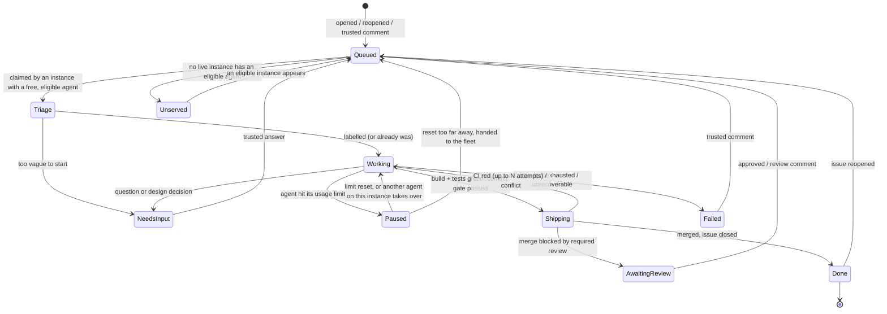

# GitHubIssueWorker

[](https://github.com/Hawkynt/GitHubIssueWorker/blob/main/LICENSE)
[](https://github.com/Hawkynt/GitHubIssueWorker)

[](https://github.com/Hawkynt/GitHubIssueWorker/actions/workflows/ci.yml)


[](https://github.com/Hawkynt/GitHubIssueWorker/stargazers)
[](https://github.com/Hawkynt/GitHubIssueWorker/network/members)
[](https://github.com/Hawkynt/GitHubIssueWorker/issues)


[](https://github.com/Hawkynt/GitHubIssueWorker/releases/latest)
[](https://github.com/Hawkynt/GitHubIssueWorker/releases)
[](https://github.com/Hawkynt/GitHubIssueWorker/releases)

> Write an issue, get a merged pull request. GitHubIssueWorker works each issue in the repositories
> you can push to, from label to merge, by the house rules. Any number of machines and coding agents
> (Claude, Codex, Antigravity, local or cloud) share the work without doing anything twice or leaving
> an issue stranded.

## 🧭 Vision

The issue tracker becomes the only interface a maintainer needs. Writing an issue is the same as
assigning it, a comment is a review, and reopening is "not done yet". Everything between the request
and the merged change is handled by workers that follow the same discipline a careful human
contributor would: the specification is written down before the code, the expected behaviour becomes
executable scenarios, the code speaks the domain's language, and every behaviour starts as a failing
test.

A worker is a deterministic shell around a non-deterministic core. A coding agent does the thinking
(triage, design, tests, code) inside a sandboxed worktree. Everything outward-facing (push, pull
request, merge, close, comment) is done by the worker itself, and only after it has checked the
result: build and tests green, every commit conforming to the house rules, no trace of who or what
wrote it. A change that cannot pass those checks is never shipped. It comes back to the issue as a
question.

Workers form a fleet without a server. Any number of instances (on a desktop, on a laptop, in a
container, in the cloud), each with whatever agents it has, watch the same repositories and
coordinate through the repositories themselves. A claim on an issue is an atomic write to a hidden git
ref, so exactly one instance works an issue at a time. A claim that is not renewed expires, so a
vanished instance never blocks anything. An instance claims only what it can start right now, so
nothing is ever reserved by someone who cannot work on it. Agent usage limits are treated as weather,
not failure: the affected agent stops taking work, its issue is paused or handed on, and it resumes
on its own when the limit resets.

It is built for one maintainer running many repositories under their own account, and it never acts
on a repository that account cannot push to.

## ✨ Features

- **Watch list of repositories** — add a repository by URL. Push access is verified up front and
  again on every start.
- **New issues, new comments, reopened issues** — detected by polling with conditional requests, so
  an idle repository costs no rate limit.
- **Automatic triage** — an unlabelled issue gets labels chosen from the repository's existing label
  set.
- **Spec → scenarios → domain → tests → code** — every issue is worked SDD, BDD, DDD and TDD, in that
  order. See [How an issue is worked](#-how-an-issue-is-worked).
- **Any agent, mixed freely** — Claude Code, Codex and Antigravity out of the box, plus any CLI agent
  (including local models) through a command template, and cloud agents through remote adapters. See
  [Agents](#-agents).
- **A fleet without a server** — instances on different machines coordinate through atomic claims
  stored in the watched repositories. No double work, no orphaned issues, no reservations. See
  [Fleet coordination](#-fleet-coordination).
- **Usage-limit aware** — an agent that hits its limit is detected, stops taking work, and its issue
  is paused, switched to another agent or handed to another machine. It resumes when the limit resets.
  See [Usage limits](#-usage-limits).
- **House-rule commits** — prefixed subjects (`+ - * # !`), one concern per commit, signed with your
  key, authored as you, no AI attribution. A commit gate checks all of it before anything is pushed.
- **Pull request linked to the issue** — the branch appears in the issue's *Development* panel and
  the PR closes the issue on merge.
- **CI-aware merge** — the worker waits for required checks, feeds failures back for repair, rebases
  when the base moves, merges with the repository's allowed method and closes the issue.
- **Asks instead of guessing** — ambiguity, impossibility or a large design decision becomes a
  comment with concrete options and a recommendation. Work resumes on your answer, on whichever
  machine is free.
- **Rework loop** — a comment on an open issue or its PR becomes follow-up commits. A reopened issue
  gets a new branch and PR that build on the earlier work.
- **State lives on GitHub** — progress is visible as `worker:*` labels, and claims, checkpoints and
  hand-off journals live in hidden refs of the repository. Any instance can pick up where another
  stopped.
- **Trusted input only** — only issues and comments from people with write access (or an explicit
  allowlist) are acted on.

## 📦 Installation

Requires Python 3.13 or newer on Linux or Windows. Install the command into its own environment
with [`pipx`](https://pipx.pypa.io) or [`uv`](https://docs.astral.sh/uv/), straight from the
repository or from a wheel attached to the
[latest nightly](https://github.com/Hawkynt/GitHubIssueWorker/releases):

```bash
pipx install git+https://github.com/Hawkynt/GitHubIssueWorker
# or
uv tool install git+https://github.com/Hawkynt/GitHubIssueWorker
```

The worker drives tools you already use, and must find each of them working:

| Tool | Needed for | Check |
| --- | --- | --- |
| [`git`](https://git-scm.com) | clone, branch, commit, push, claims. Commit signing configured when your repositories require signatures | `git config commit.gpgsign` |
| [`gh`](https://cli.github.com) | authentication only: the worker reads its token | `gh auth status` |
| at least one agent CLI | triage and implementation, run headless | see [Agents](#-agents) |

When `gh` is configured under a different home directory than the one the worker runs in, point the
worker at it with `GH_CONFIG_DIR`, or set `GH_TOKEN` directly.

## 🚀 Quick start

```bash
github-issue-worker add https://github.com/Hawkynt/ShiftDiff  # verifies push access, creates worker:* labels
github-issue-worker agents                                    # lists the agents found on this machine and their state
github-issue-worker watch                                     # runs until stopped; Ctrl+C finishes the current step
```

Then open an issue in that repository. Within one poll interval it is labelled `worker:working`. The
next thing you see is either a question in the issue or a merged pull request with the issue closed.

Run the same three commands on a second machine and the two share the work. Nothing else needs to be
configured: they find each other's claims in the repository.

`github-issue-worker watch --dry-run` does everything except write: it logs every claim, label,
comment, push and merge it would have made.

## 🔄 Issue lifecycle

Every watched issue is in exactly one state, and every state except *idle* and *done* is visible as a
label on the issue. *Queued* means unclaimed: any eligible instance may take it.



In addition, **any claimed state falls back to Queued when its claim expires**, which is what happens
when the instance holding it crashes, loses its network or is switched off. The next instance resumes
from the last checkpoint.

| State | Label | Claimed? | What is happening |
| --- | --- | :---: | --- |
| Queued | `worker:queued` | no | Waiting for any instance with a free slot and an eligible, available agent. |
| Unserved | `worker:unserved` | no | No live instance can serve the issue's routing labels. One comment says which capability is missing. |
| Triage / Working | `worker:working` | yes | Labelling, then implementing in the claimant's worktree. |
| Paused | `worker:paused` | yes | The agent hit its usage limit. The claimant holds the issue until the reset, at most `maxPauseHold`. |
| Shipping | `worker:working` | yes | Pushed, PR open, waiting for checks or merging. |
| NeedsInput | `worker:needs-input` | no | A question is in the issue. Work is checkpointed, so whoever claims the answer continues from it. |
| AwaitingReview | `worker:awaiting-review` | no | PR is green but the ruleset requires an approving review. |
| Failed | `worker:failed` | no | Gave up. The last comment says why and what was tried. |
| Done | — | no | PR merged, issue closed with a summary comment. |

Only states that are actively being worked hold a claim. An issue waiting for a human or a review
holds nothing, so it never ties up a machine.

What counts as an event:

| Event | Effect |
| --- | --- |
| Issue opened by a trusted author | Queued. |
| Issue reopened | Queued as a *reopen run*: a fresh branch from the current base, primed with the previous run's journal and the reason. |
| Trusted comment on an open issue | Queued as a *rework run*. With an open PR, follow-up commits go onto that PR. While the issue is claimed, the comment waits and is delivered to the claimant when its run ends. |
| Trusted review or review comment on the worker's PR | Same as a comment on the issue. |
| Comment on a closed issue | Ignored. Reopening is the signal. |
| Any comment carrying the worker's marker | Ignored. That is a worker's own output, from any instance, even though it is posted under your account. |
| Anything from an untrusted author | Ignored and logged. |
| Issue labelled `worker:skip` | Never touched. A run in progress is stopped at its next checkpoint and its claim released. |
| Issue labelled `agent:<kind>` or `needs:<tag>` | Routing: only instances with a matching agent kind or tag may claim it. |

## 🧠 How an issue is worked

The worker hands the issue to an agent with a fixed working contract, then checks the result itself
instead of trusting the report. The contract, in order:

1. **Spec-driven (SDD).** Read the repository's specification (README, `SPEC.md`, `PRD.md` or
   whatever the repo's `AGENTS.md` names) and decide whether the issue changes specified behaviour.
   If it does, the spec is amended first, in its own commit, and the code is written against the
   amended text.
2. **Behaviour-driven (BDD).** Turn the issue into acceptance scenarios in *Given / When / Then* form.
   They go into the pull-request description, and each one is backed by at least one automated test
   named after it.
3. **Domain-driven (DDD).** Use the repository's existing vocabulary for the concepts the issue
   touches, keep domain logic in the domain layer, and introduce a new term only when the domain
   genuinely gained one, then use it consistently in code, tests and spec.
4. **Test-driven (TDD).** For each scenario: a failing test, observed failing, then the smallest
   change that makes it pass, then refactor on green. Bug fixes start with the test that reproduces
   the bug.
5. **Done means verified.** The repository's own build and test commands pass on a clean checkout of
   the branch, and every acceptance scenario is green. "Looks right" is not done.

The target repository's own `AGENTS.md`, `CLAUDE.md` and `CONTRIBUTING.md` are part of the prompt
and override the defaults above where they are stricter.

Throughout the run the agent keeps a **journal** (`.ghiw/journal.md` in the worktree, never
committed): the scenarios, the decisions taken and why, what is done and what is next. The journal is
what lets a different agent, or the same agent on a different machine, continue the work after a
pause, a crash or a hand-off without starting over.

**When the worker asks instead of acting.** A run ends with a question in the issue, not a guess,
when:

- the issue admits more than one reasonable reading and they lead to different code;
- the change needs a large design decision: a new dependency, a breaking public-API change, a data or
  storage migration, a new top-level component, or a change that contradicts the spec;
- the request is impossible or contradicts itself;
- the budget for the run is exhausted, or CI keeps failing after the configured number of repair
  attempts.

The question comment names the options, the trade-off of each, and the one the worker recommends, so
that "go with your recommendation" is a complete answer.

## 🤹 Agents

An agent is a coding CLI the worker can run headless in a worktree. Every agent is driven through
the same contract, so agents are interchangeable mid-issue:

- **Input:** one prompt file with the issue, the trusted comments, the run kind, the working contract
  and, when continuing, the journal and the checkpoint it resumes from.
- **Output:** `.ghiw/outcome.json` in the worktree (`outcome`: `done` / `needs-input` / `impossible`,
  `summary`, `scenarios`, `questions[]` with options and a recommendation). Agents that can enforce a
  JSON schema natively are given one as well. The outcome file is the contract, so an agent without
  that feature still works.
- **Signals:** an adapter turns the agent's own output into *progress*, *cost*, *session id* and
  *usage limit* events. Usage-limit detection is the part that differs most between vendors. See
  [Usage limits](#-usage-limits).

| Kind | Invocation | Continues a conversation with | Native schema | Limit signal |
| --- | --- | --- | :---: | --- |
| `claude` | `claude -p --output-format stream-json --verbose` | `--session-id` / `--resume` | `--json-schema` | `rate_limit_event` (`status`, `resetsAt`), `api_error: usage_limit_reached` |
| `codex` | `codex exec --json` | `codex exec resume <id>` | `--output-schema` | `error` / `turn.failed` message text, "try again at …" |
| `antigravity` | `agy -p --output-format stream-json`, under a pseudo-terminal | `--conversation <uuid>` | — | message and log text |
| `command` | any CLI, from a configured argument template | template-defined | — | configured patterns + exit code |
| `remote` | a vendor's cloud agent: submit, poll, collect the diff | vendor-defined | — | vendor API |

A conversation is continued natively only when the same instance resumes with the same agent.
Everywhere else (another agent, another machine, a cloud agent) the next run starts a fresh
conversation primed with the journal and the checkpoint, which is why the journal is mandatory.

Every agent is configured with an **account**: an opaque name for the subscription or key it bills
against. Usage limits belong to accounts, not to agents or machines, so two instances sharing one
subscription also share its limit (see [Usage limits](#-usage-limits)).

**Choosing an agent.** For each issue an instance considers only its agents that match the issue's
routing labels (`agent:<kind>`, `needs:<tag>`) and are currently available. It takes the one with the
lowest `priority` value, and among equals the one with the most headroom left. Triage uses the
cheapest available agent that can produce structured output.

Remote agents do not push. Their result is collected into the instance's worktree and goes through
the same verification and commit gate as a local run, so a cloud agent cannot bypass the house rules.

## 🌐 Fleet coordination

Instances never talk to each other. They read and write three kinds of hidden ref in each watched
repository. They are outside `refs/heads` and `refs/tags`, so clones, branch lists and the default
branch's ruleset never see them:

| Ref | Holds |
| --- | --- |
| `refs/ghiw/claims/<issue>` | Who works the issue, until when, at which step, and which events are already consumed. |
| `refs/ghiw/wip/<issue>` | The latest checkpoint: the branch's commits plus a snapshot of uncommitted work, and the journal. |
| `refs/ghiw/instances/<instance>` | Presence: the instance's agents and tags, its free slots, and the usage state of each account it uses. |

**A claim is a compare-and-swap.** Every change to a claim is a new commit whose parent is the claim
as last seen, pushed with `git push --force-with-lease=<ref>:<expected>`. Creating a claim expects
the ref to be absent. Git applies the push only if the ref still holds the expected value, so of any
number of instances racing for the same issue, exactly one wins and the others are told so. (Measured
against github.com: six concurrent creates of one claim ref produced one winner, stale updates and
stale deletes were rejected. GitHub's REST ref-update endpoint, by contrast, accepted a
non-fast-forward update with `force=false`, so it is not used for claims.)

The claim's `claim.json` records:

```json
{
  "issue": 42,
  "holder": { "instance": "office-pc-7f3a", "agent": "claude-max" },
  "generation": 7,
  "state": "working",
  "step": "implement",
  "renewedAt": "2026-10-30T12:11:12Z",
  "expiresAt": "2026-10-30T12:21:12Z",
  "pausedUntil": null,
  "consumedThrough": { "comment": 2398177412, "review": null },
  "takeovers": 1,
  "branch": "issue/42-retry-on-timeout"
}
```

**Leases, not locks.** A claim is valid until `expiresAt`, and the holder renews it every third of
the lease time (default lease 10 minutes). Times come from GitHub's own `Date` header, never from the
local clock, so machines with skewed clocks still agree on what has expired. An expired claim may be
taken over by anyone, with the same compare-and-swap, and `generation` goes up by one.

**Fencing.** Before every outward write (push, comment, label, merge) the holder confirms that its
claim is still current and has at least a third of its lease left. Otherwise it stops at once. A
renewal that is rejected means someone else took over: the run is abandoned and its local work is
discarded, because the new holder resumes from the last checkpoint, not from this machine. Writes
carry their own guards too: the issue branch is pushed with `--force-with-lease` against the commit
this holder last pushed, and the merge passes the expected head `sha`, so a holder that lost its claim
cannot overwrite or merge somebody else's work.

**No reservations.** An instance claims an issue only when, at that moment, it has a free slot
(`maxConcurrentIssues`) and an agent that is eligible for the issue, available, and below its
claim-stop threshold. It never queues claims ahead of time, and it releases every claim it holds when
it shuts down cleanly. Issues waiting for a human (NeedsInput, AwaitingReview) are released, not held.

**No double work.** Pollers on every instance only find *candidates*. Whether an event still needs
work is decided by the claim's `consumedThrough`: a comment counts as handled only once the holder has
advanced `consumedThrough` past it in a successful compare-and-swap at the end of the run that used
it. Comments posted by any instance carry the marker and are never candidates. Two instances that see
the same new comment race for the claim, and the loser drops it.

**Checkpoints.** The holder pushes a checkpoint to `refs/ghiw/wip/<issue>` after each step, every
`checkpointInterval` (default 5 minutes) during a run, and before it pauses or releases. A checkpoint
is a commit whose first parent is the issue branch's local head and whose tree is the full worktree,
uncommitted changes included. A new holder checks out the branch commits and restores the rest as
uncommitted work. The issue branch itself only ever receives verified, gate-checked commits.

**Nothing stalls.** Every way an issue can get stuck has a recovery:

| Situation | Recovery |
| --- | --- |
| The holder crashed, lost its network or was switched off | Its claim expires, and the next eligible instance takes it over from the last checkpoint. |
| The holder lost its claim but does not know it yet | Fencing stops it before its next write. |
| The agent hit its usage limit | [Usage limits](#-usage-limits): another agent continues, or the claim is held briefly, or it is handed to the fleet. |
| No live instance can serve the issue's routing | `worker:unserved` and one comment naming the missing capability. Re-queued as soon as presence shows a capable instance. |
| The issue crashes every holder it meets | After `maxTakeovers` takeovers without progress: `worker:failed` with the evidence, and no further attempts until a trusted comment. |
| Labels drifted from claims (a manual edit, a crash between two writes) | The claim is the truth. The holder or, for unclaimed issues, any instance repairs the label on its next poll. |
| A presence ref was never cleaned up | Instances whose heartbeat is older than three intervals are treated as gone, and their refs are pruned by whoever notices. |

**Concurrency per repository** is a fleet-wide soft limit (`maxActiveIssuesPerRepository`, default
2): an instance does not claim when it already sees that many live claims in the repository. Two
instances racing can exceed it briefly. Merges need no lock, because each one is guarded by its
expected head `sha` and conflicts go back through rebase and re-verification.

## ⏳ Usage limits

Every subscription and most API keys have usage windows (five-hourly, weekly, a spend cap). The
worker treats hitting one as an ordinary, expected event.

**Detection is layered**, strongest signal first, because no vendor's headless output is reliable on
its own:

1. A structured event: Claude's `rate_limit_event` with `status: rejected` and `resetsAt`.
2. A structured error on the result: `api_error: usage_limit_reached`.
3. Message text matched by the adapter's patterns ("You've hit your usage limit", "weekly limit ·
   resets 11am (UTC)", "try again at …"), with the reset time parsed in the timezone the agent states,
   or the agent machine's own.
4. The agent's transcript or log file, read when the process exits non-zero with no outcome (Claude
   can exit 1 with the limit message only in the transcript).
5. *Suspected limit*: the agent died without an outcome and without any of the above, twice in a row
   on the same account. The account is treated as limited with no known reset.

Each adapter's patterns are pinned by tests against captured real outputs, so a vendor changing its
wording breaks a test, not the fleet.

**Warnings stop new claims early.** When an agent reports that a window is nearly used up (Claude's
`allowed_warning`, or utilisation at or above `stopClaimingAt`, default 90 %), it finishes its current
issue but takes no new one.

**When the limit hits during a run**, the holder checkpoints immediately and then, in this order:

1. **Switch agents locally.** If this instance has another eligible, available agent on a different
   account, it continues the issue at once with that agent, primed from the journal.
2. **Hold briefly.** Otherwise, if the reset is at most `maxPauseHold` away (default 30 minutes), it
   keeps the claim in state `paused` with `pausedUntil`, keeps renewing it, and resumes when the limit
   resets.
3. **Hand to the fleet.** Otherwise it releases the claim to Queued with the checkpoint and journal,
   so any instance with an available agent can continue now. If nobody can, this instance's own agent
   picks it up again after the reset like any other queued issue.

**Limits are shared by account.** The limited account and its reset time are published in the
instance's presence ref, so every other instance using the same account stops trying it without
spending a failed run to find out.

**Resuming is automatic.** At the reset time (plus a small random jitter, so a fleet does not stampede)
the instance sends one minimal probe request to the account. On success the account is available
again and paused issues continue. With no known reset time, probes back off from 5 minutes to an hour.

## ⚙️ Configuration

One JSON file: `~/.config/GitHubIssueWorker/config.json` on Linux (`$XDG_CONFIG_HOME` respected),
`%APPDATA%\GitHubIssueWorker\config.json` on Windows, or `--config <path>`. The `add` and `remove`
commands edit it, and everything else is optional. Each machine has its own file. The machines
share nothing but the repositories.

```json
{
  "instance": {
    "name": "office-pc",
    "tags": ["linux", "gpu"],
    "maxConcurrentIssues": 2
  },
  "pollInterval": "00:01:00",
  "trustedUsers": [],
  "agents": [
    { "id": "claude-max", "kind": "claude", "account": "anthropic-max", "model": "opus", "priority": 1, "maxBudgetUsdPerRun": 10 },
    { "id": "codex", "kind": "codex", "account": "openai-plus", "priority": 2 },
    { "id": "agy", "kind": "antigravity", "account": "google-pro", "priority": 3 },
    { "id": "local", "kind": "command", "account": "local", "priority": 4, "tags": ["local"],
      "command": ["my-agent", "--prompt-file", "{prompt}", "--cwd", "{worktree}"],
      "limitPatterns": [] }
  ],
  "fleet": {
    "leaseTime": "00:10:00",
    "checkpointInterval": "00:05:00",
    "maxPauseHold": "00:30:00",
    "maxTakeovers": 3,
    "stopClaimingAt": 0.9
  },
  "defaults": {
    "mode": "all",
    "baseBranch": null,
    "mergeMethod": "squash",
    "ciRepairAttempts": 3,
    "processBacklog": false,
    "createMissingLabels": false,
    "maxActiveIssuesPerRepository": 2,
    "runTimeout": "02:00:00"
  },
  "repositories": [
    { "repository": "Hawkynt/ShiftDiff" },
    { "repository": "Hawkynt/MediaUploadService", "mode": "labeled", "test": "pytest -q" }
  ]
}
```

| Key | Default | Meaning |
| --- | --- | --- |
| `instance.name` | host name | Human-readable name in presence and logs. A random suffix makes the instance id unique. |
| `instance.tags` | `[]` | Capabilities matched against `needs:<tag>` routing labels. |
| `instance.maxConcurrentIssues` | 1 | Issues this instance works at the same time. |
| `pollInterval` | 1 min | Time between polls of one repository, with a random jitter of ±10 %. |
| `trustedUsers` | `[]` | Logins trusted in addition to everyone with write access. |
| `agents[].kind` | — | `claude`, `codex`, `antigravity`, `command` or `remote`. |
| `agents[].account` | — | Opaque name of what the agent bills against. Limits are tracked per account. |
| `agents[].priority` | 100 | Lower is preferred. |
| `agents[].tags` | `[]` | Extra capabilities of this agent, matched like instance tags. |
| `agents[].model`, `maxBudgetUsdPerRun` | agent default | Passed to agents that support them. |
| `agents[].executable`, `command`, `limitPatterns` | per kind | Override or define how the agent is run and how its limits are recognised. |
| `fleet.leaseTime` | 10 min | Claim validity without renewal. |
| `fleet.checkpointInterval` | 5 min | Checkpoint cadence during a run. |
| `fleet.maxPauseHold` | 30 min | Longest wait for a reset before the issue is handed to the fleet. |
| `fleet.maxTakeovers` | 3 | Takeovers without progress before an issue is marked failed. |
| `fleet.stopClaimingAt` | 0.9 | Reported utilisation at which an agent takes no new issues. |
| `mode` | `all` | `all`: every trusted issue. `labeled`: only issues carrying the `worker` label. |
| `baseBranch` | repo default | Branch that work starts from and merges into. |
| `mergeMethod` | `squash` | Used when the repository allows it, else the first allowed method. |
| `ciRepairAttempts` | 3 | Red-CI repair rounds before asking. |
| `processBacklog` | `false` | On first watch, also queue issues that were already open. Off, so adding a repository never starts a flood. |
| `createMissingLabels` | `false` | Let triage create a label that does not exist yet. The `worker:*` labels are always created. |
| `maxActiveIssuesPerRepository` | 2 | Fleet-wide soft limit of claimed issues in one repository. |
| `runTimeout` | 2 h | Wall-clock limit of one agent run. |
| `build` / `test` | detected | Verification commands. Detected from `AGENTS.md`/`CONTRIBUTING.md`, then from the stack (`*.sln[x]`, `package.json`, `pyproject.toml`, `Cargo.toml`, …). |

Local state (poll cursors, ETags, native conversation ids, costs) lives in
`~/.local/state/GitHubIssueWorker/` (`%LOCALAPPDATA%` on Windows). Clones and worktrees live under
`~/.cache/GitHubIssueWorker/`. Deleting either loses nothing the repositories do not also know.

## 🛡️ Security

Issue text is input to an agent that can run commands on your machine, so the worker treats it as
untrusted until proven otherwise:

- **Only trusted authors.** An issue or comment is acted on only when its author holds `write`,
  `maintain` or `admin` permission on the repository (asked of the collaborator-permission endpoint
  and cached per poll cycle, because an association of `COLLABORATOR` alone can mean read-only), or
  the login is in `trustedUsers`. Bots are never trusted. Anyone else's text is never put into a
  prompt, including as context for a trusted comment.
- **No agent can reach outward.** Every agent run is denied `git push`, `gh`, and the GitHub API
  where the agent supports tool restrictions, and runs without a GitHub token either way. Pushing,
  claiming, commenting, labelling and merging are done by the worker after its own checks.
- **No secrets in the worktree.** The run's environment is scrubbed of `GH_TOKEN`, `GITHUB_TOKEN`
  and the worker's own credentials. The token is never written to disk, logs, checkpoints or claims.
  Agent credentials stay with the agent CLIs.
- **Claims are readable by anyone who can read the repository.** They carry instance names, agent
  ids and account names exactly as configured, plus step and timing. Use neutral names in public
  repositories. No vendor or agent name is ever written into a commit, a PR or a comment.
- **Isolation is recommended.** For repositories that accept issues from collaborators you do not
  fully trust, run the worker as a dedicated OS user or in a container. The worktree is the only
  directory the run is meant to write to.

## 🗺️ Roadmap

This checklist is the product requirements document. Each item is one requirement with its
acceptance criterion. An item is ticked when that criterion is covered by a passing test or, for
operational items, demonstrated on a real repository. Commits that implement an item cite its id.

**Priorities:** 🟥 must for v1 · 🟧 should for v1 · 🟦 later.

### F0 — Foundation

- [x] 🟥 **F0.1** House-standard repository: license, editorconfig, gitignore, AGENTS, CONTRIBUTING,
  smoke/CI/nightly/release workflows in the house Python dialect, README checked by `repo-readme`.
- [x] 🟥 **F0.2** Package skeleton (`pyproject.toml`, `src/github_issue_worker`, `tests/`) that is
  `ruff`/`mypy --strict` clean and tests green, with a `github-issue-worker --version` entry point.
- [ ] 🟥 **F0.3** Configuration loads from the platform path or `--config`, validates every key, and
  reports an invalid key by its JSON path. Unknown keys are an error, not ignored.
- [ ] 🟥 **F0.4** Structured log to console plus one log file per repository and per issue run.
  Secrets are redacted.
- [ ] 🟥 **F0.5** Authentication resolves `GH_TOKEN`, then `GITHUB_TOKEN`, then `gh auth token`
  (honouring `GH_CONFIG_DIR`). A missing or expired token fails at start with the command that fixes
  it.
- [ ] 🟥 **F0.6** Start-up preflight: `git` and `gh` are found and runnable, every configured agent
  answers a version probe (an agent that does not is disabled with the reason, and the instance runs
  with the rest), and commit signing is configured when a watched repository's ruleset requires
  signatures. Each failure names the tool and the fix.

### F1 — Watched repositories

- [ ] 🟥 **F1.1** `add <repo>` accepts `https://github.com/o/r`, `git@github.com:o/r.git`, `o/r` and
  an issue URL, and stores the normalised `owner/repo`.
- [ ] 🟥 **F1.2** `add` refuses a repository the authenticated account cannot push to
  (`permissions.push` is false), and says so.
- [ ] 🟥 **F1.3** `add` creates the `worker:*` labels that do not exist yet.
- [ ] 🟥 **F1.4** `remove <repo>` and `list` (last poll, state counts, current issue).
- [ ] 🟥 **F1.5** Push access is re-checked on every start and every hour. A repository that lost it
  is suspended with a log entry, not skipped silently.
- [ ] 🟧 **F1.6** Per-repository overrides for every key under `defaults`, plus `build` and `test`.

### F2 — Event detection

- [ ] 🟥 **F2.1** Polls issues (`state=all`, `since`) and issue comments (`since`) per repository,
  plus reviews and review comments of the worker's open PRs, all with `If-None-Match`. An unchanged
  repository answers `304` and costs no rate limit.
- [ ] 🟥 **F2.2** Classifies events as *opened*, *reopened*, *commented*, *review-commented*,
  *routing-changed* and *labelled-skip*. Pull requests returned by the issues endpoint are not
  treated as issues.
- [ ] 🟥 **F2.3** Ignores every comment carrying the worker's marker (`<!-- ghiw:… -->`), whichever
  instance wrote it, so output under your account never triggers any instance.
- [ ] 🟥 **F2.4** Ignores input from untrusted authors (see Security above) and logs it.
- [ ] 🟥 **F2.5** First watch of a repository records the current position and queues nothing unless
  `processBacklog` is on.
- [ ] 🟥 **F2.6** Honours `X-RateLimit-Remaining`/`Reset` and secondary-limit `Retry-After`, and
  backs off instead of failing.
- [ ] 🟧 **F2.7** `mode: labeled` acts only on issues carrying `worker`. `worker:skip` is honoured in
  every mode and stops a run in progress at its next checkpoint.
- [ ] 🟦 **F2.8** Optional webhook receiver as an alternative to polling, for hosts that are
  reachable.

### F3 — Queue and state

- [ ] 🟥 **F3.1** An instance works at most `maxConcurrentIssues` issues and claims a new one only
  under the [no-reservation rule](#-fleet-coordination). Among claimable issues it takes the oldest
  pending event first.
- [ ] 🟥 **F3.2** Progress is mirrored as exactly one `worker:*` label per issue, matching the
  [lifecycle](#-issue-lifecycle). Only the claim holder writes the label of a claimed issue.
- [ ] 🟥 **F3.3** Local state is written atomically (write-temp-then-rename), so a crash leaves the
  old or the new state, never a torn one.
- [ ] 🟥 **F3.4** Crash recovery: an issue whose claim expired is resumed, by this or any other
  instance, from its claim's last completed step (triage, implement, push, PR, checks, merge, close)
  and its last checkpoint. It is not restarted from scratch.
- [ ] 🟥 **F3.5** Events that arrive while an issue is claimed are coalesced and delivered to the
  holder when its run ends. None is lost, and five quick comments produce one rework run.
- [ ] 🟥 **F3.6** Single-instance lock per configuration on one machine. A second `watch` with the same
  configuration exits with the PID of the first. Instances with different configurations, on the same
  or other machines, are coordinated by claims.
- [ ] 🟧 **F3.7** `priority:high`/`priority:low` labels reorder the queue.

### F4 — Triage

- [ ] 🟥 **F4.1** An issue with no labels gets one or more labels from the repository's existing set,
  chosen by a tool-less run of the cheapest available agent that can return structured output.
- [ ] 🟥 **F4.2** Labels that do not exist are never created unless `createMissingLabels` is on.
- [ ] 🟥 **F4.3** An issue that already carries a non-`worker:*` label is not relabelled.
- [ ] 🟧 **F4.4** Triage may conclude the issue is too vague to start, which goes straight to
  [F8](#f8--asking-for-input) with the missing information named.

### F5 — Workspace

- [ ] 🟥 **F5.1** One cached clone per repository, fetched before each run.
- [ ] 🟥 **F5.2** One `git worktree` per issue on branch `issue/<n>-<slug>`, created from the freshly
  fetched base branch, or from the latest checkpoint when continuing.
- [ ] 🟥 **F5.3** The branch is linked to the issue (GraphQL `createLinkedBranch`), so it shows in the
  issue's *Development* panel.
- [ ] 🟥 **F5.4** Commits use your git identity and signing configuration. The worker never sets an
  author, committer or e-mail of its own.
- [ ] 🟧 **F5.5** Worktrees are removed after merge, after release to the fleet, and after losing a
  claim. Failed ones are kept, and pruned after a configurable number of days.

### F6 — Implementation run

- [ ] 🟥 **F6.1** Runs the chosen agent headless in the worktree through its adapter, with the
  per-issue prompt file, and reads the outcome from `.ghiw/outcome.json` (`outcome` `done` /
  `needs-input` / `impossible`, `summary`, `scenarios`, `questions[]` with options and a
  recommendation). Where the agent supports a native schema, it is passed as well.
- [ ] 🟥 **F6.2** The prompt carries the issue title and body, every trusted comment in order, the
  labels, the run kind (first / rework / reopen / CI repair / continuation), the target repository's
  `AGENTS.md`, `CLAUDE.md` and `CONTRIBUTING.md`, and when continuing the journal and the checkpoint
  description.
- [ ] 🟥 **F6.3** The [working contract](#-how-an-issue-is-worked) (SDD → BDD → DDD → TDD) and the
  journal duty are part of every implementation prompt.
- [ ] 🟥 **F6.4** Every agent is denied `git push`, `gh` and GitHub API access where it supports tool
  restrictions, and every agent's environment carries no GitHub token.
- [ ] 🟥 **F6.5** Each adapter switches its agent's own attribution off where the agent has one
  (Claude: `--settings`), so no co-author trailer or footer is added. The commit gate (F7.1) catches
  whatever an agent adds anyway.
- [ ] 🟥 **F6.6** Independent verification after `done`: clean working tree, configured or detected
  build and test commands pass, at least one commit on the branch. A failed check returns the output
  to the same conversation, once, before the issue is parked.
- [ ] 🟥 **F6.7** `runTimeout` and the budget are enforced. Hitting either parks the issue with a
  comment stating what was finished and what was not.
- [ ] 🟧 **F6.8** Each run's transcript, agent id and cost (where the agent reports one) are kept with
  the issue's local log.

### F7 — Commit, push, pull request, merge, close

- [ ] 🟥 **F7.1** Commit gate on every commit between base and branch head: subject starts with
  `+ - * # !`, never with "fix"/"bugfix"/"changed"/"modified", has a body, and contains no AI trace
  (`Co-Authored-By` naming an AI, "Generated with", 🤖, mentions of Claude, Anthropic, Codex, OpenAI,
  Gemini, Antigravity, AI, LLM or agents). A failing commit is sent back for rewording, and is never
  pushed as is.
- [ ] 🟥 **F7.2** Pushes only the issue branch, always with `--force-with-lease` against the commit
  this holder last pushed. Never pushes the base branch.
- [ ] 🟥 **F7.3** Opens the pull request with the house-style title, a body containing the summary,
  the BDD scenarios, the verification evidence and `Closes #<n>`, plus the marker.
- [ ] 🟥 **F7.4** Waits for the required checks. Red checks hand the failing job's log back to the
  agent, up to `ciRepairAttempts` times, then ask.
- [ ] 🟥 **F7.5** When the base moved or conflicts: rebase, re-verify (F6.6), push. Unresolvable
  conflicts go back to the agent.
- [ ] 🟥 **F7.6** Merges with `mergeMethod` (or the first method the repository allows), passing the
  expected head `sha`, and deletes the branch.
- [ ] 🟥 **F7.7** Merge blocked by a required review: label `worker:awaiting-review`, comment once,
  release the claim. The approval is an event like any other, and whoever claims it merges.
- [ ] 🟥 **F7.8** After the merge the issue is closed as *completed*, explicitly if `Closes` did not
  do it (e.g. the base is not the default branch), with a summary comment linking the PR and merge
  commit. The claim is then marked `done`, and the checkpoint ref deleted.

### F8 — Asking for input

- [ ] 🟥 **F8.1** A `needs-input` or `impossible` outcome posts one comment with the questions, the
  options, their trade-offs and the recommendation, labels `worker:needs-input`, checkpoints and
  releases the claim.
- [ ] 🟥 **F8.2** The next trusted comment queues the issue, and whoever claims it continues from the
  checkpoint and journal with the answer. The same instance with the same agent resumes the native
  conversation.
- [ ] 🟥 **F8.3** A parked issue is never pinged again by the worker. Silence costs nothing.
- [ ] 🟧 **F8.4** An answer that does not resolve the question produces a follow-up question rather
  than a guess.

### F9 — Rework

- [ ] 🟥 **F9.1** A trusted comment on an open issue with an open worker PR adds follow-up commits to
  that PR's branch and re-enters F7.4.
- [ ] 🟥 **F9.2** A reopened issue gets a fresh branch `issue/<n>-<slug>-r<k>` from the current base,
  a run that is primed with the previous journal and told why it was reopened, and a new PR that
  references the previous one.
- [ ] 🟥 **F9.3** Comments on closed issues are ignored.
- [ ] 🟧 **F9.4** Reviews and review comments on the worker's PR are treated as rework input, and
  each review thread is answered or resolved.

### F10 — Operation

- [ ] 🟥 **F10.1** `watch`: poll loop until stopped. The first `Ctrl+C`/`SIGTERM` finishes the current
  step, checkpoints and releases every claim. The second aborts, and the claims then expire.
- [ ] 🟥 **F10.2** `once`: one poll-and-work pass, for cron or a scheduler.
- [ ] 🟥 **F10.3** `work <owner/repo#n>`: claim and work exactly one issue now, ignoring the queue
  order but never another instance's valid claim.
- [ ] 🟥 **F10.4** `--dry-run` on every command: no claim, label, comment, push, merge or file outside
  the cache is written, and each would-be write is logged.
- [ ] 🟧 **F10.5** `status`: this instance's claims and agents, and fleet-wide per repository: live
  instances, claims with holder, step and expiry, paused issues with their reset, unserved issues.
- [ ] 🟧 **F10.6** Service recipes: a systemd user unit and a Windows scheduled task, documented and
  tested on both.
- [ ] 🟦 **F10.7** Per-day and per-repository cost ceilings across runs.
- [ ] 🟦 **F10.8** Container image and recipe for running an instance in the cloud.

### F11 — Fleet coordination

- [ ] 🟥 **F11.1** Claims are created, renewed, taken over, released and completed only by
  `git push --force-with-lease` compare-and-swap on `refs/ghiw/claims/<issue>`. With N concurrent
  claimants, exactly one succeeds (tested with parallel claimants against a real remote).
- [ ] 🟥 **F11.2** Claim times use GitHub's `Date` header. An instance with a local clock skewed by an
  hour neither steals a valid claim nor keeps an expired one (tested with a skewed fake clock).
- [ ] 🟥 **F11.3** Renewal every `leaseTime / 3`. A holder that cannot renew stops all outward writes
  once less than a third of the lease is left. A rejected renewal abandons the run.
- [ ] 🟥 **F11.4** Takeover of an expired claim increments `generation` and `takeovers`, and resumes
  from the claim's step and the latest checkpoint.
- [ ] 🟥 **F11.5** Checkpoints to `refs/ghiw/wip/<issue>` after each step, every
  `checkpointInterval`, and before pause or release. Restoring one reproduces the branch commits and
  the uncommitted worktree exactly.
- [ ] 🟥 **F11.6** `consumedThrough` advances only in the compare-and-swap that ends the run which
  used the events. Two instances seeing the same comment produce exactly one rework run.
- [ ] 🟥 **F11.7** No-reservation rule: a claim is attempted only with a free slot and an eligible,
  available agent below `stopClaimingAt`. Waiting states (NeedsInput, AwaitingReview, Failed) hold no
  claim.
- [ ] 🟥 **F11.8** Presence on `refs/ghiw/instances/<id>`: agents, tags, free slots, per-account usage
  state and version, renewed every lease third. Stale presence (older than three intervals) is
  ignored and pruned.
- [ ] 🟥 **F11.9** Routing: `agent:<kind>` and `needs:<tag>` restrict who may claim. An issue no live
  instance can serve is labelled `worker:unserved` with one explanatory comment, and re-queued when a
  capable instance appears.
- [ ] 🟥 **F11.10** `maxTakeovers` takeovers without progress mark the issue failed with the evidence.
- [ ] 🟧 **F11.11** `maxActiveIssuesPerRepository` is honoured fleet-wide from the visible claims.
- [ ] 🟧 **F11.12** Done claims and checkpoint refs of closed issues are garbage-collected after 30
  days, by compare-and-swap delete.
- [ ] 🟦 **F11.13** Simulation test: 5 instances, 3 agent kinds, random crashes, network cuts and
  usage limits over 200 issues. Every issue ends merged, waiting for input or failed with a reason,
  and none is worked twice.

### F12 — Agents

- [ ] 🟥 **F12.1** One adapter protocol for every agent: prepare prompt, start, stream signals
  (progress, cost, session id, usage limit), cancel, collect outcome. A fake adapter drives the
  application tests.
- [ ] 🟥 **F12.2** `claude` adapter: `claude -p --output-format stream-json --verbose`,
  `--session-id`/`--resume`, `--json-schema`, `--max-budget-usd`, `--model`, attribution off, tool
  restrictions for push/`gh`.
- [ ] 🟥 **F12.3** `codex` adapter: `codex exec --json`, `codex exec resume <id>`, `--output-schema`,
  workspace-write sandbox, `--model`.
- [ ] 🟥 **F12.4** `antigravity` adapter: `agy -p --output-format stream-json`, `--conversation`,
  `--mode accept-edits`, run under a pseudo-terminal because `agy -p` can lose its output without a
  TTY.
- [ ] 🟥 **F12.5** `command` adapter: argument template with `{prompt}`, `{worktree}`, `{outcome}`,
  `{session}` placeholders, configured limit patterns and exit codes, for any further CLI agent
  including local models.
- [ ] 🟥 **F12.6** `agents` command lists configured agents with version, account, availability and
  any known reset time.
- [ ] 🟥 **F12.7** Agent choice per issue: routing match, availability, lowest `priority`, then most
  headroom. Triage uses the cheapest structured-output agent.
- [ ] 🟥 **F12.8** Continuation across agents: a run started by one agent kind is finished by another
  from the journal and checkpoint, with no repeated commits (tested claude → codex → antigravity with
  fakes).
- [ ] 🟦 **F12.9** `remote` adapter for vendor cloud agents: submit the task with the checkpoint,
  poll, collect the diff into the worktree, then the same verification and commit gate as a local
  run.

### F13 — Usage limits

- [ ] 🟥 **F13.1** Layered detection per adapter (structured event → result error → message text →
  transcript/log → suspected), each layer covered by tests on captured real outputs.
- [ ] 🟥 **F13.2** Reset time taken from the signal, else parsed from the text in the stated or local
  timezone, else unknown with probe back-off from 5 minutes to 1 hour.
- [ ] 🟥 **F13.3** A limited account takes no new claims on any agent that uses it, and the limit is
  published in presence so other instances with the same account skip it too.
- [ ] 🟥 **F13.4** Warning level (`allowed_warning` or utilisation ≥ `stopClaimingAt`): finish the
  current issue, claim nothing new.
- [ ] 🟥 **F13.5** Limit during a run: checkpoint, then switch to another local agent on a different
  account, else hold `paused` while the reset is within `maxPauseHold`, else release to the fleet.
- [ ] 🟥 **F13.6** At reset plus jitter, one minimal probe. On success, paused issues resume and the
  account takes claims again, with no human action.
- [ ] 🟧 **F13.7** `status` shows each account's state, reset time and which issues wait on it.

## 🏗️ Architecture

Ports and adapters. The domain decides, and the adapters touch the world.

```
src/github_issue_worker/
  domain/        WatchedRepository, IssueWorkItem, IssueState (state machine), IssueEvent, Trust,
                 Claim (lease, generation, fencing), Checkpoint, Journal, AgentProfile, Account,
                 UsageState, Routing, CommitMessage (house-rule validation), RunOutcome; pure, no I/O
  application/   Poller, EventClassifier, Scheduler (eligibility, no-reservation, agent choice),
                 Coordinator (claim, renew, take over, release), Presence, Triage, Implementer,
                 Verifier, Shipper (push, PR, checks, merge, close), InputRequester, LimitMonitor
  ports/         GitHubApi, Git, ClaimStore, AgentAdapter, StateStore, Clock, ProcessRunner
                 (typing.Protocol)
  adapters/      GitHub REST/GraphQL over httpx; git, claims and checkpoints via the git CLI;
                 agents: claude, codex, antigravity, command, remote; JSON state store;
                 configuration; logging
  cli/           add, remove, list, agents, watch, once, work, status

tests/
  domain + application   state machine, claims and fencing, scheduler, limit handling, commit gate,
                         against in-memory fakes and a fake clock
  adapters               recorded HTTP fixtures, a local bare git remote for claims, fake agent
                         executables replaying captured vendor output
  e2e                    against a scratch GitHub repository with several instances; marker e2e
```

Three rules hold the design together. **Every GitHub write goes through one `Shipper`**, which is
where the dry-run, the commit gate, the marker and the fencing check live, so no path can bypass
them. **Every step is idempotent and checkpointed**: a step repeated after a crash or a takeover
detects its own earlier effect and skips it, which is what makes F3.4 and F11.4 possible. **The claim
is the only lock**: there is no coordinator process, and any instance can disappear at any moment
without blocking the others for longer than one lease.

The worker is asynchronous (`asyncio`): polling, lease renewal, waiting for checks and supervising
agent subprocesses are all waiting, and one event loop serves every watched repository.

## 🔌 Dependencies

| Dependency | Kind | Why |
| --- | --- | --- |
| Python 3.13+ | runtime | `asyncio`, `subprocess`, `json`, `dataclasses`. |
| [`httpx`](https://www.python-httpx.org) | runtime | Async HTTP for the REST and GraphQL calls, with ETag and rate-limit handling under the worker's own control. |
| `git` | runtime | Clones, worktrees, commits, signing, push, and the compare-and-swap that claims rely on. |
| `gh` | runtime, optional | Source of the token only. `GH_TOKEN` replaces it. |
| [`claude`](https://docs.claude.com/en/docs/claude-code), [`codex`](https://github.com/openai/codex), [`agy`](https://antigravity.google) | runtime, any subset | The agents. At least one is needed. |
| `pytest`, `ruff`, `mypy`, `build` | development | Tests, lint and format, strict typing, packaging. |

No GitHub SDK: the handful of calls the worker makes are thin enough that a client library would add
more surface than it removes.

## ⚠️ Limitations

- **It merges without a human review, by design.** Watch only repositories where that is acceptable,
  or require a review in the ruleset and the worker will wait for it (F7.7).
- **It acts as you.** Comments, commits and merges carry your account, from every instance. The
  hidden marker is how the workers tell their own comments apart, so a marker copied into a comment
  by hand hides that comment from them.
- **Polling, not push.** Reaction time is the poll interval. Webhooks are F2.8.
- **A takeover costs up to one lease.** An instance that dies holds its issue until its claim expires
  (10 minutes by default), and work since its last checkpoint (5 minutes by default) is redone.
- **Per-repository concurrency is soft.** Instances racing for different issues of one repository
  can briefly exceed `maxActiveIssuesPerRepository`.
- **Usage-limit detection depends on vendor output.** Headless CLIs report limits as text, in
  structured events, or sometimes not at all, and change between versions. Captured-output tests
  make a change visible, and the *suspected limit* fallback keeps an unrecognised limit from turning
  into a failure loop. It still costs one or two failed runs.
- **Quality is bounded by the repository's tests.** The worker verifies against what the repository
  can check. A repository with no tests gets only the tests the run wrote itself.

## 🛠️ Building

```bash
python -m venv .venv && source .venv/bin/activate      # Windows: .venv\Scripts\activate
pip install -e '.[dev]'
ruff check . && ruff format --check . && mypy         # lint, format, types
pytest -q                                             # everything
pytest -q -m "not slow and not e2e and not os_integration and not external_interop"   # the fast tier
python -m build                                       # wheel + sdist into dist/
```

## 🤝 Contributing

Read [`AGENTS.md`](AGENTS.md) and [`CONTRIBUTING.md`](CONTRIBUTING.md) first. They are binding for
people and agents alike. Work against a roadmap item and cite its id (`F7.1`) in the commit body. A
change that alters behaviour updates this README in the same pull request, because this README is
the specification.

## 🆘 Getting Help

Open an [issue](https://github.com/Hawkynt/GitHubIssueWorker/issues) with the command you ran, the
relevant part of the issue's log file, the output of `github-issue-worker status`, and the worker's
version (`github-issue-worker --version`).

## ❤️ Support

If this project saves you time or money, consider supporting its development:

[](https://github.com/sponsors/Hawkynt)
[](https://www.paypal.me/hawkynt)

## 📜 License

Licensed under LGPL-3.0-or-later — see [LICENSE](LICENSE).
