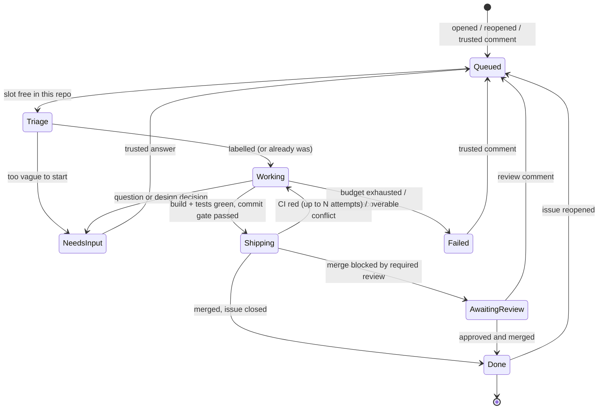

# GitHubIssueWorker

[](https://github.com/Hawkynt/GitHubIssueWorker/blob/main/LICENSE)
[](https://github.com/Hawkynt/GitHubIssueWorker)

[](https://github.com/Hawkynt/GitHubIssueWorker/actions/workflows/ci.yml)


[](https://github.com/Hawkynt/GitHubIssueWorker/stargazers)
[](https://github.com/Hawkynt/GitHubIssueWorker/network/members)
[](https://github.com/Hawkynt/GitHubIssueWorker/issues)


[](https://github.com/Hawkynt/GitHubIssueWorker/releases/latest)
[](https://github.com/Hawkynt/GitHubIssueWorker/releases)
[](https://github.com/Hawkynt/GitHubIssueWorker/releases)

> Write an issue, get a merged pull request. GitHubIssueWorker watches the GitHub repositories you can
> push to and works each new issue to completion: label, branch, specify, test, implement, commit by
> the house rules, open the pull request, wait for CI, merge, close. It asks in the issue when a
> decision belongs to you, and picks the work back up when you answer, comment or reopen.

## 🧭 Vision

The issue tracker becomes the only interface a maintainer needs. Writing an issue is the same as
assigning it, a comment is a review, and reopening is "not done yet". Everything between the request
and the merged change is handled by a worker that follows the same discipline a careful human
contributor would: the specification is written down before the code, the expected behaviour becomes
executable scenarios, the code speaks the domain's language, and every behaviour starts as a failing
test.

The worker is a deterministic shell around a non-deterministic core. The `claude` CLI does the
thinking (triage, design, tests, code) inside a sandboxed worktree. Everything outward-facing (push,
pull request, merge, close, comment) is done by the worker itself, and only after it has checked the
result: build and tests green, every commit conforming to the house rules, no trace of who or what
wrote it. A change that cannot pass those checks is never shipped. It comes back to the issue as a
question.

It is built for one maintainer running many repositories from their own machine, under their own
account, and it never acts on a repository that account cannot push to.

## ✨ Features

- **Watch list of repositories** — add a repository by URL. Push access is verified up front and
  again on every start.
- **New issues, new comments, reopened issues** — detected by polling with conditional requests, so
  an idle repository costs no rate limit.
- **Automatic triage** — an unlabelled issue gets labels chosen from the repository's existing label
  set.
- **Spec → scenarios → domain → tests → code** — every issue is worked SDD, BDD, DDD and TDD, in that
  order. See [How an issue is worked](#-how-an-issue-is-worked).
- **House-rule commits** — prefixed subjects (`+ - * # !`), one concern per commit, signed with your
  key, authored as you, no AI attribution. A commit gate checks all of it before anything is pushed.
- **Pull request linked to the issue** — the branch appears in the issue's *Development* panel and
  the PR closes the issue on merge.
- **CI-aware merge** — the worker waits for required checks, feeds failures back for repair, rebases
  when the base moves, merges with the repository's allowed method and closes the issue.
- **Asks instead of guessing** — ambiguity, impossibility or a large design decision becomes a
  comment with concrete options and a recommendation. Work resumes on your answer.
- **Rework loop** — a comment on an open issue or its PR becomes follow-up commits. A reopened issue
  gets a new branch and PR, continuing the same conversation.
- **State lives on GitHub** — progress is visible as `worker:*` labels, and a crashed or restarted
  worker reconciles from the issues themselves.
- **Trusted input only** — only issues and comments from people with write access (or an explicit
  allowlist) are acted on.

## 📦 Installation

Requires Python 3.13 or newer on Linux or Windows. Install the command into its own environment
with [`pipx`](https://pipx.pypa.io) or [`uv`](https://docs.astral.sh/uv/), straight from the
repository or from a wheel attached to the
[latest nightly](https://github.com/Hawkynt/GitHubIssueWorker/releases):

```bash
pipx install git+https://github.com/Hawkynt/GitHubIssueWorker
# or
uv tool install git+https://github.com/Hawkynt/GitHubIssueWorker
```

The worker drives three tools you already use, and must find each of them working:

| Tool | Needed for | Check |
| --- | --- | --- |
| [`git`](https://git-scm.com) | clone, branch, commit, push. Commit signing configured when your repositories require signatures | `git config commit.gpgsign` |
| [`gh`](https://cli.github.com) | authentication only: the worker reads its token | `gh auth status` |
| [`claude`](https://docs.claude.com/en/docs/claude-code) | triage and implementation, run headless | `claude -p "say ok"` |

When `gh` is configured under a different home directory than the one the worker runs in, point the
worker at it with `GH_CONFIG_DIR`, or set `GH_TOKEN` directly.

## 🚀 Quick start

```bash
github-issue-worker add https://github.com/Hawkynt/ShiftDiff  # verifies push access, creates worker:* labels
github-issue-worker watch                                     # runs until stopped; Ctrl+C finishes the current step
```

Then open an issue in that repository. Within one poll interval it is labelled `worker:queued`, then
`worker:working`. The next thing you see is either a question in the issue or a merged pull request
with the issue closed.

`github-issue-worker watch --dry-run` does everything except write: it logs every label, comment, push
and merge it would have made.

## 🔄 Issue lifecycle

Every watched issue is in exactly one state, and every state except *idle* and *done* is visible as a
label on the issue.



| State | Label | What the worker is doing |
| --- | --- | --- |
| Queued | `worker:queued` | Waiting for this repository's slot (one issue at a time per repository). |
| Triage / Working | `worker:working` | Labelling, then implementing in the issue's worktree. |
| Shipping | `worker:working` | Pushed, PR open, waiting for checks or merging. |
| NeedsInput | `worker:needs-input` | Parked. A question is in the issue. The worktree and conversation are kept. |
| AwaitingReview | `worker:awaiting-review` | PR is green but the ruleset requires an approving review. |
| Failed | `worker:failed` | Gave up. The last comment says why and what was tried. |
| Done | — | PR merged, issue closed with a summary comment. |

What counts as an event:

| Event | Effect |
| --- | --- |
| Issue opened by a trusted author | Queued. |
| Issue reopened | Queued as a *reopen run*: a fresh branch from the current base, the previous conversation resumed with the reason. |
| Trusted comment on an open issue | Queued as a *rework run*. With an open PR, follow-up commits go onto that PR. While a run is active, the comment is held and fed in when the run ends. |
| Trusted review or review comment on the worker's PR | Same as a comment on the issue. |
| Comment on a closed issue | Ignored. Reopening is the signal. |
| Any comment carrying the worker's marker | Ignored. That is the worker's own output, even though it is posted under your account. |
| Anything from an untrusted author | Ignored and logged. |
| Issue labelled `worker:skip` | Never touched. A run in progress is stopped and its worktree kept. |

## 🧠 How an issue is worked

The worker hands the issue to `claude` with a fixed working contract, then checks the result itself
instead of trusting the report. The contract, in order:

1. **Spec-driven (SDD).** Read the repository's specification (README, `SPEC.md`, `PRD.md` or
   whatever the repo's `AGENTS.md` names) and decide whether the issue changes specified behaviour.
   If it does, the spec is amended first, in its own commit, and the code is written against the
   amended text.
2. **Behaviour-driven (BDD).** Turn the issue into acceptance scenarios in *Given / When / Then* form.
   They go into the pull-request description, and each one is backed by at least one automated test
   named after it.
3. **Domain-driven (DDD).** Use the repository's existing vocabulary for the concepts the issue
   touches, keep domain logic in the domain layer, and introduce a new term only when the domain
   genuinely gained one, then use it consistently in code, tests and spec.
4. **Test-driven (TDD).** For each scenario: a failing test, observed failing, then the smallest
   change that makes it pass, then refactor on green. Bug fixes start with the test that reproduces
   the bug.
5. **Done means verified.** The repository's own build and test commands pass on a clean checkout of
   the branch, and every acceptance scenario is green. "Looks right" is not done.

The target repository's own `AGENTS.md`, `CLAUDE.md` and `CONTRIBUTING.md` are part of the prompt
and override the defaults above where they are stricter.

**When the worker asks instead of acting.** A run ends with a question in the issue, not a guess,
when:

- the issue admits more than one reasonable reading and they lead to different code;
- the change needs a large design decision: a new dependency, a breaking public-API change, a data or
  storage migration, a new top-level component, or a change that contradicts the spec;
- the request is impossible or contradicts itself;
- the budget for the run is exhausted, or CI keeps failing after the configured number of repair
  attempts.

The question comment names the options, the trade-off of each, and the one the worker recommends, so
that "go with your recommendation" is a complete answer.

## ⚙️ Configuration

One JSON file: `~/.config/GitHubIssueWorker/config.json` on Linux (`$XDG_CONFIG_HOME` respected),
`%APPDATA%\GitHubIssueWorker\config.json` on Windows, or `--config <path>`. The `add` and `remove`
commands edit it, and everything else is optional.

```json
{
  "pollInterval": "00:01:00",
  "maxParallelRepositories": 2,
  "trustedUsers": [],
  "claude": {
    "executable": "claude",
    "model": "opus",
    "maxBudgetUsdPerRun": 10,
    "runTimeout": "02:00:00"
  },
  "defaults": {
    "mode": "all",
    "baseBranch": null,
    "mergeMethod": "squash",
    "ciRepairAttempts": 3,
    "processBacklog": false,
    "createMissingLabels": false
  },
  "repositories": [
    { "repository": "Hawkynt/ShiftDiff" },
    { "repository": "Hawkynt/MediaUploadService", "mode": "labeled", "test": "pytest -q" }
  ]
}
```

| Key | Default | Meaning |
| --- | --- | --- |
| `pollInterval` | 1 min | Time between polls of one repository. |
| `maxParallelRepositories` | 2 | Repositories worked at the same time. Within a repository it is always one issue at a time. |
| `trustedUsers` | `[]` | Logins trusted in addition to everyone with write access. |
| `claude.model` | CLI default | Passed as `--model`. |
| `claude.maxBudgetUsdPerRun` | 10 | Passed as `--max-budget-usd`. Exceeding it parks the issue with a question. |
| `claude.runTimeout` | 2 h | Wall-clock limit of one run. |
| `mode` | `all` | `all`: every trusted issue. `labeled`: only issues carrying the `worker` label. |
| `baseBranch` | repo default | Branch that work starts from and merges into. |
| `mergeMethod` | `squash` | Used when the repository allows it, else the first allowed method. |
| `ciRepairAttempts` | 3 | Red-CI repair rounds before asking. |
| `processBacklog` | `false` | On first watch, also queue issues that were already open. Off, so adding a repository never starts a flood. |
| `createMissingLabels` | `false` | Let triage create a label that does not exist yet. The `worker:*` labels are always created. |
| `build` / `test` | detected | Verification commands. Detected from `AGENTS.md`/`CONTRIBUTING.md`, then from the stack (`*.sln[x]`, `package.json`, `pyproject.toml`, `Cargo.toml`, …). |

Local state (poll cursors, ETags, conversation ids, attempt counters, costs) lives in
`~/.local/state/GitHubIssueWorker/` (`%LOCALAPPDATA%` on Windows). Clones and worktrees live under
`~/.cache/GitHubIssueWorker/`. Deleting either loses nothing that GitHub does not also know.

## 🛡️ Security

Issue text is input to an agent that can run commands on your machine, so the worker treats it as
untrusted until proven otherwise:

- **Only trusted authors.** An issue or comment is acted on only when its author holds `write`,
  `maintain` or `admin` permission on the repository (asked of the collaborator-permission endpoint
  and cached per poll cycle, because an association of `COLLABORATOR` alone can mean read-only), or
  the login is in `trustedUsers`. Bots are never trusted. Anyone else's text is never put into a
  prompt, including as context for a trusted comment.
- **Claude cannot reach outward.** The implementation run is denied `git push`, `gh`, and the GitHub
  API. Pushing, commenting, labelling and merging are done by the worker after its own checks.
- **No secrets in the worktree.** The run's environment is scrubbed of `GH_TOKEN`, `GITHUB_TOKEN`
  and the worker's own credentials, and the token is never written to disk or logs.
- **Isolation is recommended.** For repositories that accept issues from collaborators you do not
  fully trust, run the worker as a dedicated OS user or in a container. The worktree is the only
  directory the run is meant to write to.

## 🗺️ Roadmap

This checklist is the product requirements document. Each item is one requirement with its
acceptance criterion. An item is ticked when that criterion is covered by a passing test or, for
operational items, demonstrated on a real repository. Commits that implement an item cite its id.

**Priorities:** 🟥 must for v1 · 🟧 should for v1 · 🟦 later.

### F0 — Foundation

- [x] 🟥 **F0.1** House-standard repository: license, editorconfig, gitignore, AGENTS, CONTRIBUTING,
  smoke/CI/nightly/release workflows in the house Python dialect, README checked by `repo-readme`.
- [x] 🟥 **F0.2** Package skeleton (`pyproject.toml`, `src/github_issue_worker`, `tests/`) that is
  `ruff`/`mypy --strict` clean and tests green, with a `github-issue-worker --version` entry point.
- [ ] 🟥 **F0.3** Configuration loads from the platform path or `--config`, validates every key, and
  reports an invalid key by its JSON path. Unknown keys are an error, not ignored.
- [ ] 🟥 **F0.4** Structured log to console plus one log file per repository and per issue run.
  Secrets are redacted.
- [ ] 🟥 **F0.5** Authentication resolves `GH_TOKEN`, then `GITHUB_TOKEN`, then `gh auth token`
  (honouring `GH_CONFIG_DIR`). A missing or expired token fails at start with the command that fixes
  it.
- [ ] 🟥 **F0.6** Start-up preflight: `git`, `gh` and `claude` are found and runnable, and commit
  signing is configured when a watched repository's ruleset requires signatures. Each failure names
  the tool and the fix.

### F1 — Watched repositories

- [ ] 🟥 **F1.1** `add <repo>` accepts `https://github.com/o/r`, `git@github.com:o/r.git`, `o/r` and
  an issue URL, and stores the normalised `owner/repo`.
- [ ] 🟥 **F1.2** `add` refuses a repository the authenticated account cannot push to
  (`permissions.push` is false), and says so.
- [ ] 🟥 **F1.3** `add` creates the `worker:*` labels that do not exist yet.
- [ ] 🟥 **F1.4** `remove <repo>` and `list` (last poll, state counts, current issue).
- [ ] 🟥 **F1.5** Push access is re-checked on every start and every hour. A repository that lost it
  is suspended with a log entry, not skipped silently.
- [ ] 🟧 **F1.6** Per-repository overrides for every key under `defaults`, plus `build` and `test`.

### F2 — Event detection

- [ ] 🟥 **F2.1** Polls issues (`state=all`, `since`) and issue comments (`since`) per repository,
  plus reviews and review comments of the worker's open PRs, all with `If-None-Match`. An unchanged
  repository answers `304` and costs no rate limit.
- [ ] 🟥 **F2.2** Classifies events as *opened*, *reopened*, *commented*, *review-commented* and
  *labelled-skip*. Pull requests returned by the issues endpoint are not treated as issues.
- [ ] 🟥 **F2.3** Ignores every comment carrying the worker's marker (`<!-- ghiw:… -->`), so its own
  output under your account never triggers it.
- [ ] 🟥 **F2.4** Ignores input from untrusted authors (see Security above) and logs it.
- [ ] 🟥 **F2.5** First watch of a repository records the current position and queues nothing unless
  `processBacklog` is on.
- [ ] 🟥 **F2.6** Honours `X-RateLimit-Remaining`/`Reset` and secondary-limit `Retry-After`, and
  backs off instead of failing.
- [ ] 🟧 **F2.7** `mode: labeled` acts only on issues carrying `worker`. `worker:skip` is honoured in
  every mode and stops a run in progress.
- [ ] 🟦 **F2.8** Optional webhook receiver as an alternative to polling, for hosts that are
  reachable.

### F3 — Queue and state

- [ ] 🟥 **F3.1** One active issue per repository and at most `maxParallelRepositories` at once.
  Oldest event first.
- [ ] 🟥 **F3.2** Progress is mirrored as exactly one `worker:*` label per issue, matching the
  [lifecycle](#-issue-lifecycle).
- [ ] 🟥 **F3.3** Local state is written atomically (write-temp-then-rename), so a crash leaves the
  old or the new state, never a torn one.
- [ ] 🟥 **F3.4** Crash recovery: on start, an issue labelled `worker:working` with no live run is
  resumed from its last completed step (triage, implement, push, PR, checks, merge, close). It is not
  restarted from scratch.
- [ ] 🟥 **F3.5** Events that arrive during a run are coalesced and delivered when the run ends.
  None is lost, and five quick comments produce one rework run.
- [ ] 🟥 **F3.6** Single-instance lock per configuration. A second `watch` exits with the PID of the
  first.
- [ ] 🟧 **F3.7** `priority:high`/`priority:low` labels reorder the queue.

### F4 — Triage

- [ ] 🟥 **F4.1** An issue with no labels gets one or more labels from the repository's existing set,
  chosen by a tool-less `claude -p` call constrained with `--json-schema`.
- [ ] 🟥 **F4.2** Labels that do not exist are never created unless `createMissingLabels` is on.
- [ ] 🟥 **F4.3** An issue that already carries a non-`worker:*` label is not relabelled.
- [ ] 🟧 **F4.4** Triage may conclude the issue is too vague to start, which goes straight to
  [F8](#f8--asking-for-input) with the missing information named.

### F5 — Workspace

- [ ] 🟥 **F5.1** One cached clone per repository, fetched before each run.
- [ ] 🟥 **F5.2** One `git worktree` per issue on branch `issue/<n>-<slug>`, created from the freshly
  fetched base branch.
- [ ] 🟥 **F5.3** The branch is linked to the issue (GraphQL `createLinkedBranch`), so it shows in the
  issue's *Development* panel.
- [ ] 🟥 **F5.4** Commits use your git identity and signing configuration. The worker never sets an
  author, committer or e-mail of its own.
- [ ] 🟧 **F5.5** Worktrees are removed after merge. Failed or parked ones are kept, and pruned after
  a configurable number of days.

### F6 — Implementation run

- [ ] 🟥 **F6.1** Runs `claude -p` in the worktree with `--output-format json`, a per-issue
  `--session-id` (later runs use `--resume`), `--max-budget-usd`, and a `--json-schema` result
  contract: `outcome` (`done` / `needs-input` / `impossible`), `summary`, `scenarios`,
  `questions[]` with options and a recommendation.
- [ ] 🟥 **F6.2** The prompt carries the issue title and body, every trusted comment in order, the
  labels, the run kind (first / rework / reopen / CI repair), and the target repository's
  `AGENTS.md`, `CLAUDE.md` and `CONTRIBUTING.md`.
- [ ] 🟥 **F6.3** The [working contract](#-how-an-issue-is-worked) (SDD → BDD → DDD → TDD) is part of
  every implementation prompt.
- [ ] 🟥 **F6.4** The run is denied `git push`, `gh` and GitHub API access, and its environment
  carries no GitHub token.
- [ ] 🟥 **F6.5** Attribution is switched off for the run (`--settings`), so `claude` adds no
  co-author trailer or footer of its own.
- [ ] 🟥 **F6.6** Independent verification after `done`: clean working tree, configured or detected
  build and test commands pass, at least one commit on the branch. A failed check returns the output
  to the same conversation, once, before the issue is parked.
- [ ] 🟥 **F6.7** `runTimeout` and the budget are enforced. Hitting either parks the issue with a
  comment stating what was finished and what was not.
- [ ] 🟧 **F6.8** Each run's transcript and cost (`total_cost_usd`) are kept with the issue's log.

### F7 — Commit, push, pull request, merge, close

- [ ] 🟥 **F7.1** Commit gate on every commit between base and branch head: subject starts with
  `+ - * # !`, never with "fix"/"bugfix"/"changed"/"modified", has a body, and contains no AI trace
  (`Co-Authored-By` naming an AI, "Generated with", 🤖, mentions of Claude, Anthropic, AI, LLM or
  agents). A failing commit is sent back for rewording, and is never pushed as is.
- [ ] 🟥 **F7.2** Pushes only the issue branch. Never pushes the base branch, and force-pushes only
  its own issue branch after a rebase, with `--force-with-lease`.
- [ ] 🟥 **F7.3** Opens the pull request with the house-style title, a body containing the summary,
  the BDD scenarios, the verification evidence and `Closes #<n>`, plus the marker.
- [ ] 🟥 **F7.4** Waits for the required checks. Red checks hand the failing job's log back to the
  conversation, up to `ciRepairAttempts` times, then ask.
- [ ] 🟥 **F7.5** When the base moved or conflicts: rebase, re-verify (F6.6), push. Unresolvable
  conflicts go back to the conversation.
- [ ] 🟥 **F7.6** Merges with `mergeMethod` (or the first method the repository allows) and deletes
  the branch.
- [ ] 🟥 **F7.7** Merge blocked by a required review: label `worker:awaiting-review`, comment once,
  merge when approved.
- [ ] 🟥 **F7.8** After the merge the issue is closed as *completed*, explicitly if `Closes` did not
  do it (e.g. the base is not the default branch), with a summary comment linking the PR and merge
  commit.

### F8 — Asking for input

- [ ] 🟥 **F8.1** A `needs-input` or `impossible` outcome posts one comment with the questions, the
  options, their trade-offs and the recommendation, labels `worker:needs-input` and parks the issue.
  The worktree and conversation are kept.
- [ ] 🟥 **F8.2** The next trusted comment resumes the same conversation with the answer, and the
  label goes back to `worker:working`.
- [ ] 🟥 **F8.3** A parked issue is never pinged again by the worker. Silence costs nothing.
- [ ] 🟧 **F8.4** An answer that does not resolve the question produces a follow-up question rather
  than a guess.

### F9 — Rework

- [ ] 🟥 **F9.1** A trusted comment on an open issue with an open worker PR adds follow-up commits to
  that PR's branch and re-enters F7.4.
- [ ] 🟥 **F9.2** A reopened issue gets a fresh branch `issue/<n>-<slug>-r<k>` from the current base,
  a resumed conversation that is told why it was reopened, and a new PR that references the previous
  one.
- [ ] 🟥 **F9.3** Comments on closed issues are ignored.
- [ ] 🟧 **F9.4** Reviews and review comments on the worker's PR are treated as rework input, and
  each review thread is answered or resolved.

### F10 — Operation

- [ ] 🟥 **F10.1** `watch`: poll loop until stopped. The first `Ctrl+C`/`SIGTERM` finishes the current
  step and checkpoints, and the second aborts.
- [ ] 🟥 **F10.2** `once`: one poll-and-work pass, for cron or a scheduler.
- [ ] 🟥 **F10.3** `work <owner/repo#n>`: work exactly one issue now, ignoring the queue.
- [ ] 🟥 **F10.4** `--dry-run` on every command: no label, comment, push, merge or file outside the
  cache is written, and each would-be write is logged.
- [ ] 🟧 **F10.5** `status`: queue, per-issue state, time and cost per run.
- [ ] 🟧 **F10.6** Service recipes: a systemd user unit and a Windows scheduled task, documented and
  tested on both.
- [ ] 🟦 **F10.7** Per-day and per-repository cost ceilings across runs.

## 🏗️ Architecture

Ports and adapters. The domain decides, and the adapters touch the world.

```
src/github_issue_worker/
  domain/        WatchedRepository, IssueWorkItem, IssueState (state machine), IssueEvent, Trust,
                 CommitMessage (house-rule validation), RunOutcome; pure, no I/O
  application/   Poller, EventClassifier, Dispatcher (queue, slots), Triage, Implementer, Verifier,
                 Shipper (push, PR, checks, merge, close), InputRequester
  ports/         GitHubApi, Git, ClaudeRunner, StateStore, Clock, ProcessRunner  (typing.Protocol)
  adapters/      GitHub REST/GraphQL over httpx, git and claude via subprocess, JSON state store,
                 configuration, logging
  cli/           add, remove, list, watch, once, work, status

tests/
  domain + application   state machine, classifier, commit gate, dispatcher against in-memory fakes
  adapters               recorded HTTP fixtures, a local bare git repository, a fake claude executable
  e2e                    against a scratch GitHub repository; marker e2e, pull-request tier only
```

Two rules hold the design together. **Every GitHub write goes through one `Shipper`**, which is where
the dry-run, the commit gate and the marker live, so no path can bypass them. **Every step is
idempotent and checkpointed**: posting the same question twice, labelling twice or reopening a merged
PR's step after a crash is detected and skipped, which is what makes F3.4 possible.

The worker is asynchronous (`asyncio`): polling, waiting for checks and supervising `claude`
subprocesses are all waiting, and one event loop serves every watched repository.

## 🔌 Dependencies

| Dependency | Kind | Why |
| --- | --- | --- |
| Python 3.13+ | runtime | `asyncio`, `subprocess`, `json`, `dataclasses`. |
| [`httpx`](https://www.python-httpx.org) | runtime | Async HTTP for the REST and GraphQL calls, with ETag and rate-limit handling under the worker's own control. |
| `git` | runtime | Clones, worktrees, commits, signing, push. |
| `gh` | runtime, optional | Source of the token only. `GH_TOKEN` replaces it. |
| `claude` | runtime | Triage and implementation runs. |
| `pytest`, `ruff`, `mypy`, `build` | development | Tests, lint and format, strict typing, packaging. |

No GitHub SDK: the handful of calls the worker makes are thin enough that a client library would add
more surface than it removes.

## ⚠️ Limitations

- **It merges without a human review, by design.** Watch only repositories where that is acceptable,
  or require a review in the ruleset and the worker will wait for it (F7.7).
- **It acts as you.** Comments, commits and merges carry your account. The hidden marker is how the
  worker tells its own comments apart, so a marker copied into a comment by hand hides that comment
  from it.
- **Polling, not push.** Reaction time is the poll interval. Webhooks are F2.8.
- **One issue at a time per repository.** Parallel work in one repository would race on merges and
  is out of scope.
- **Quality is bounded by the repository's tests.** The worker verifies against what the repository
  can check. A repository with no tests gets only the tests the run wrote itself.

## 🛠️ Building

```bash
python -m venv .venv && source .venv/bin/activate      # Windows: .venv\Scripts\activate
pip install -e '.[dev]'
ruff check . && ruff format --check . && mypy         # lint, format, types
pytest -q                                             # everything
pytest -q -m "not slow and not e2e and not os_integration and not external_interop"   # the fast tier
python -m build                                       # wheel + sdist into dist/
```

## 🤝 Contributing

Read [`AGENTS.md`](AGENTS.md) and [`CONTRIBUTING.md`](CONTRIBUTING.md) first. They are binding for
people and agents alike. Work against a roadmap item and cite its id (`F7.1`) in the commit body. A
change that alters behaviour updates this README in the same pull request, because this README is
the specification.

## 🆘 Getting Help

Open an [issue](https://github.com/Hawkynt/GitHubIssueWorker/issues) with the command you ran, the
relevant part of the issue's log file, and the worker's version (`github-issue-worker --version`).

## ❤️ Support

If this project saves you time or money, consider supporting its development:

[](https://github.com/sponsors/Hawkynt)
[](https://www.paypal.me/hawkynt)

## 📜 License

Licensed under LGPL-3.0-or-later — see [LICENSE](LICENSE).
